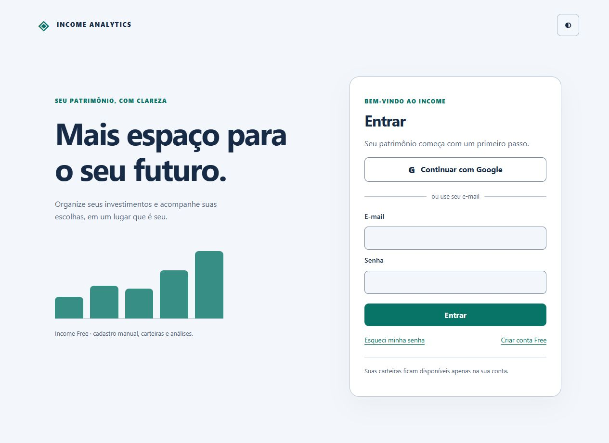
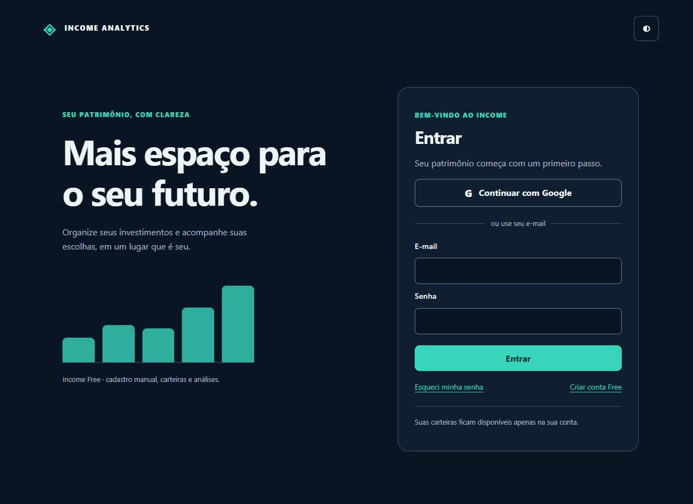
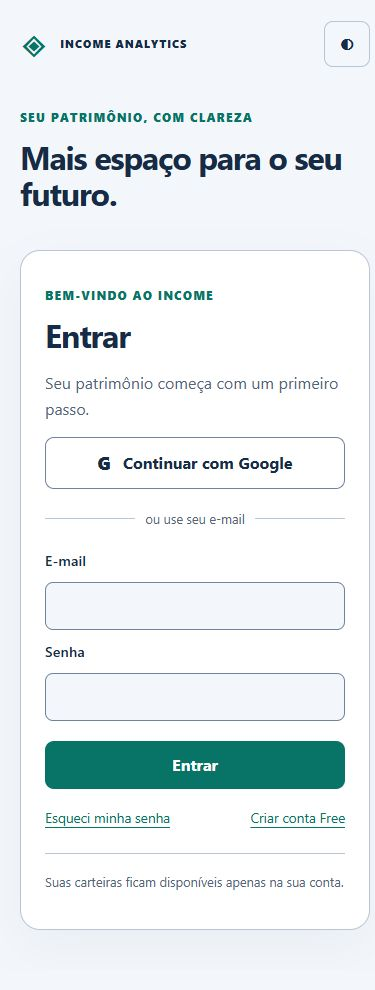
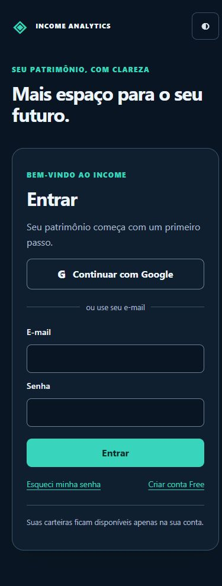

# Validação da Fase 2 — Firebase Authentication

Ambiente: Windows, Python 3.14, SQLite, Node 24, Firebase Admin Python 7.7.0 e Auth Emulator oficial em `127.0.0.1:9099`, projeto fictício `demo-income-saas`. Nenhuma credencial ou conta de produção foi criada/utilizada. As mudanças foram feitas em worktree isolada, empilhadas nas fundações da Fase 1.

## Resultados executados

| Verificação | Resultado |
|---|---|
| Regressão dirigida ampla | **134 testes Python passaram**: domínio, segurança, persistência, multiportfólio, TWR/múltiplas moedas, reconstrução histórica, explicação patrimonial e contratos do frontend |
| Rechecagem após endurecer cookie/revogação e offload de I/O | **26 testes passaram**: segurança, API multiportfólio local e escopo persistido. São testes repetidos/adicionais, não somar como contagem de casos únicos |
| Firebase real emulado — **4 testes passaram**, incluindo ações OOB de verificação e recuperação | Dois usuários de senha distintos, e-mail obrigatório, quatro carteiras, Google sintético, confirmação de vinculação, conta desativada e revogação pelo Admin SDK aprovados |
| Contraste das telas de conta | Teste WCAG AA de texto, links, limites de campos e foco passou nos dois temas |
| Cliente BFF Node | CSRF, troca de token somente em memória, seleção de carteira e limpeza de logout passaram |
| Regressão HTML | Nome de ativo com marcação inerte é escapado; não se torna elemento HTML |
| Migração em cópia consistente do banco pessoal | `0023 → 0025 → 0023`; hashes de conteúdo das **34 tabelas de dados** preservados, `integrity_check=ok`, zero violações de FK. Cópia removida; origem não migrada |
| Vínculo legado em banco temporário | Dry-run, confirmação do UID/projeto, backup anterior, ledger idêntico, idempotência e rejeição de UID errado aprovados |
| Motor/manifesto | Nenhum arquivo certificado ou cálculo foi modificado; gate bruto de hashes conserva **uma falha anterior** de CRLF/LF |

A execução ampla ocorreu antes dos testes extras de replay de JWT idêntico e da ação OOB de recuperação; a rechecagem dirigida cobre o endurecimento subsequente. Não foi executado nem declarado um pentest ou a suíte completa de todo o repositório.

Comando da regressão ampla:

```powershell
$env:INCOME_RUN_FIREBASE_EMULATOR_TESTS="1"
py -3.14 -m pytest -q tests/security tests/domain tests/infrastructure/test_portfolio_scope.py tests/infrastructure/test_saas_foundation_migration.py tests/infrastructure/test_saas_portfolio_owner.py tests/api/test_local_multiportfolio_v2.py tests/acceptance/test_frontend_modules.py tests/acceptance/test_portfolio_performance_mvp.py tests/acceptance/test_multicurrency_twr_base_currency.py tests/acceptance/test_persistence_reconstruction.py tests/acceptance/test_implicit_opening_capital_performance.py tests/application/test_historical_portfolio_reconstruction.py tests/application/test_wealth_explanation.py
node tests/frontend/firebase_auth_session.mjs
node tests/frontend/multiportfolio_context_v2.mjs
node tests/frontend/saas_xss_characterization.mjs
```

A contagem ao repetir o comando aumenta com os casos extras adicionados depois da execução ampla. Os testes reais exigem emulador + opt-in; skipped não é aprovação de Firebase.

## Falha preexistente preservada

`tests/application/test_historical_shares_units.py::test_shares_unit_020_frozen_engine` foi repetido e falhou pela mesma divergência bruta:

- `magic_formula_ranking_validation.py`: esperado `47140198ac099487f4160be411c46ef549a1d3ac3e8db25dbbc672d7133e6a37`, atual CRLF `039656c877d516ce2e2cdcf5d6bba7efadf948a92958875ecd140a16349ce83d`.
- A análise LF/CRLF já está registrada na auditoria da Fase 1. Não se editou arquivo financeiro ou manifesto para fazer o teste passar.

Esse gate permanece pendente de reconciliação formal e impede declarar certificação financeira completa para lançamento. Os testes financeiros dirigidos aprovados não substituem a certificação.

## Navegador e interface

Validação manual no navegador sobre API/banco descartáveis, sem registros reais: entrada → primeira carteira vazia → Operações → conta → logout → novo login. SDK Web atualizado para 13.1.0, inicializado diretamente com persistência em memória. Não houve erros no console ao concluir o acesso.

Telas de entrada verificadas em **1280×900** e **390×844**, temas claro/escuro; no mobile, `scrollWidth == clientWidth == 390`. Formulários têm labels, foco visível, controles com área de toque, feedback de erro/status e prevenção de submissão concorrente. A evidência visual acompanha o PR de interface, separado do PR da API.

O fluxo de Google no emulador usa identidade sintética. OAuth/consentimento Google real, domínio autorizado e entrega real de mensagens continuam dependentes do projeto Firebase selecionado. A documentação de custos/configuração não significa que um projeto tenha sido provisionado.

## Gate de liberação

Cadastro público de produção permanece fechado por padrão. Nenhum merge, deploy, migração do banco em uso, vínculo de carteira real, billing ou integração bancária foi executado. Exigir projeto e configuração reais, revisão de infraestrutura/limites/licenças, validação privada com duas contas reais e fechamento da pendência de certificação antes de publicar.


## Evidências visuais da interface

Capturas reais do navegador, com dados de demonstração em banco descartável:

| Desktop claro | Desktop escuro |
|---|---|
|  |  |

| Mobile claro | Mobile escuro | Primeiro acesso |
|---|---|---|
|  |  |  |

PRs empilhados: fundações #15 → API/autorização #16 → interface/primeiro acesso. Não fazer merge sem revisar a base e os gates de implantação. Os screenshots não contêm dados de investimento de produção.

Verificações finais de interface: **28 testes de aceitação passaram**, quatro scripts Node passaram (BFF, carteira, HTML e contraste) e os módulos JavaScript modificados passaram por verificação de sintaxe.

## Continuação: projeto income-analytics-c0150 (23/10/2026)

O operador informou que Google e Email/Password estão habilitados nesse projeto. Nesta estação, não foram localizados os identificadores públicos Web nas variáveis do processo/usuário/máquina nem nos anexos textuais consultados. GOOGLE_APPLICATION_CREDENTIALS também está ausente. Não foi aberto, copiado ou versionado JSON administrativo anterior. A revogação da chave compartilhada e o caminho de uma chave nova precisam ser confirmados pelo operador; datas de arquivo não comprovam rotação.

A integração Admin existente usa Application Default Credentials, portanto aceita GOOGLE_APPLICATION_CREDENTIALS sem incorporar a chave ao código. O .env.example agora registra o projeto informado e o kill switch explícito em 0, mantendo os demais valores como placeholders. Esse arquivo é documentação: não altera variáveis do serviço pessoal. Na ausência da flag, o backend já mantém o cadastro fechado.

Reexecução desta continuação: **16 testes Python passaram** (autorização Firebase com provedor substituto determinístico, vínculo legado em SQLite temporário e ownership). O conftest gera um novo arquivo SQLite no diretório temporário antes de importar a aplicação. **Dois scripts Node passaram**: sessão BFF/CSRF/limpeza de logout e contraste da conta em ambos os temas. Houve três avisos de depreciação, sem falhas.

Não foram repetidos nesta continuação os testes do emulador. Os resultados anteriores do emulador permanecem evidência separada; não validam OAuth Google real. Login Google, senha, entrega de e-mails, cookies e isolamento contra o projeto real ainda estão bloqueados pela configuração/credencial ausente. Não houve migração no banco pessoal, mudança no motor financeiro, merge nem publicação. Antes da exposição pública, continuam necessários os testes reais com dois usuários e os demais gates de liberação já descritos neste documento.

## Projeto real: execução de 24/10/2026

Após o operador confirmar a nova chave e a revogação da anterior, o Admin SDK autenticou via GOOGLE_APPLICATION_CREDENTIALS, lendo o arquivo externo em seu local original. Os identificadores públicos Web fornecidos pelo operador foram registrados no exemplo de ambiente; Analytics não foi integrado.

O novo teste opt-in tests/security/test_firebase_live.py passou contra income-analytics-c0150: **1 teste de integração real**, criando dois usuários temporários exclusivos do teste. Validou login REST e-mail/senha, recusa de e-mail não verificado, troca por sessão Firebase/HttpOnly no FastAPI, UUID interno, criação/listagem de carteiras isoladas, bloqueio de leitura e escrita cruzadas, logout com rejeição de replay e rejeição após desativação. As duas identidades criadas foram removidas no finally, sem tocar em usuários preexistentes. SQLite foi gerado pelo conftest no diretório temporário. Ruff e diff --check passaram.

A verificação de e-mail foi alterada administrativamente somente nas contas sintéticas: não comprova entrega de mensagem nem ação do link. O teste não usa consentimento Google real, não cria contas Google e não valida recuperação real por e-mail. Esses fluxos interativos continuam pendentes, assim como os gates de liberação anteriores. O opt-in deve ser usado separadamente dos testes com emulador e exige projeto explícito e credencial autorizada. Cadastro só foi habilitado no processo de teste com SQLite descartável; nenhuma configuração persistente do serviço financeiro foi alterada. Nenhum merge ou deploy público.

## Correção do bootstrap Google (24/10/2026)

A investigação de auth/internal-error encontrou incompatibilidade entre a CSP do Income e o SDK oficial Firebase Web 13.1.0: o SDK carrega https://apis.google.com/js/api.js no fluxo popup, mas script-src não permitia esse domínio. A origem foi adicionada explicitamente, preservando as proibições de scripts inline/eval, object-src e frame-ancestors. A mensagem de erro interno deixou de sugerir que trocar de navegador resolveria a falha.

O teste de regressão de cabeçalhos passou, assim como o script de mensagens de erro. O servidor de teste loopback foi reiniciado com o mesmo SQLite descartável. A autenticação Google completa ainda requer conclusão interativa pelo usuário; permitir o bootstrap não constitui evidência de login finalizado.

## UX da conta e identidade visual (24/10/2026)

O link isolado de conta foi substituído por um disclosure nativo no cabeçalho: avatar, configurações e saída explícita. Escape devolve foco ao acionador; clique/foco fora fecha o painel. A saída reutiliza o BFF/CSRF existente, impede envio duplicado e oferece recuperação após erro. No celular, o acionador conserva nome acessível e área de toque, ocultando apenas o texto visual. Nenhuma identidade ou token é interpolado no HTML do menu.

Marca vetorial Income compartilhada pelo aplicativo e autenticação, também usada como favicon. O símbolo Google colorido vem do asset oficial gstatic Firebase UI (https://www.gstatic.com/firebasejs/ui/2.0.0/images/auth/google.svg), preservado localmente. Não há SDK Analytics adicional.

Validação: 28 testes de módulos frontend; scripts Node de sessão, contraste e novo comportamento do menu passaram. JavaScript passou na verificação de sintaxe. Prévia visual isolada, sem dados financeiros, conferida em desktop e 390px; login também conferido. A prévia temporária foi removida após as capturas. Nenhum logout da sessão real do operador foi executado durante a inspeção.
