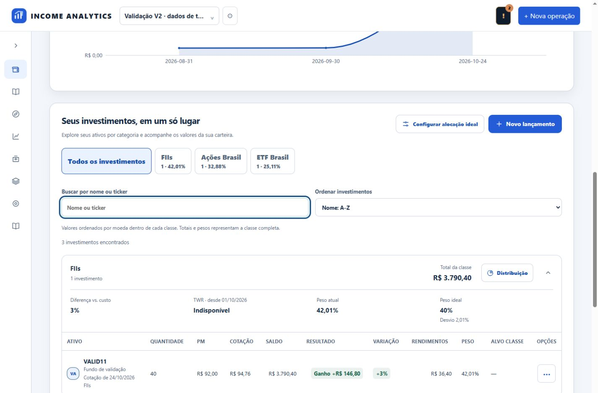
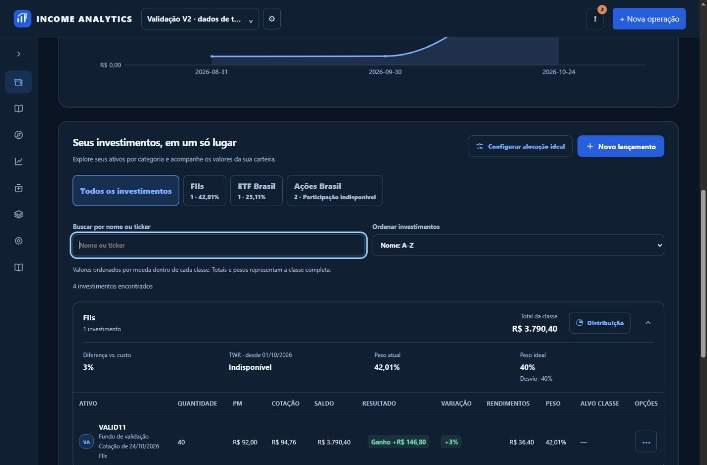
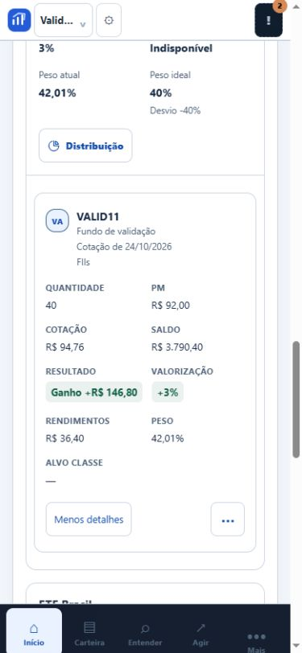
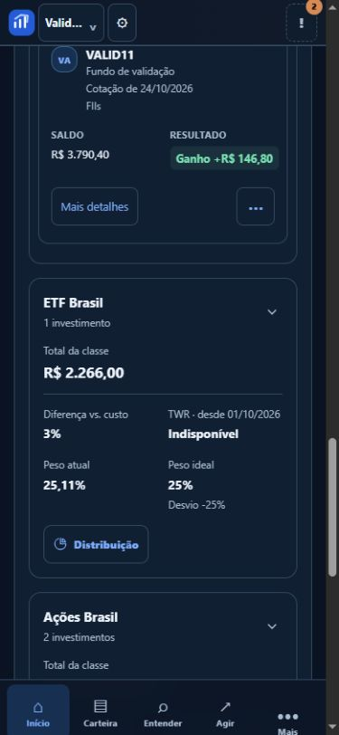

# PR 3 — Meus Ativos V2

Base: PR #24 mesclado por autorização explícita do usuário; develop ceb4e81649f11892f0dcaef9c6d2b6a6678a0acd. Branch codex/holdings-v2. Sem merge automático deste PR e sem início do PR 4.

## Entrega

O cabeçalho agora diz “Seus investimentos, em um só lugar”. Chips refletem exclusivamente as classes com posições reais no read model autorizado, com quantidade e peso fornecido pelo backend. Busca por nome/ticker ignora acentos; ordenação por nome ou valor atual mantém preços ausentes no fim. Valores de moedas diferentes não são comparados entre si: a ordenação por valor é separada por moeda dentro da classe. Totais e pesos continuam sendo os da classe inteira, mesmo sob busca, e a interface explicita essa distinção.

As tabelas mantêm todas as colunas e ações. Nome, ticker e classe ficam visíveis; ganho/perda têm texto, sinal e tokens semânticos. No mobile, cartões compactos destacam identidade, saldo e resultado, com “Mais detalhes” para todas as demais métricas. Ações de compra/venda e consulta de lançamentos continuam usando os fluxos e confirmações existentes. Agrupamento e paginação de lançamentos por ativo permanecem inalterados; não havia paginação da lista de posições por classe e não foi criada uma limitação artificial.

Estados: skeleton estático acessível, carteira vazia com ação de adicionar, filtro vazio com limpeza, erro com tentativa novamente, preço ausente sem valor zero substituto. Uma nova consulta limpa o read model anterior e fecha diálogos dependentes da carteira. Respostas antigas são invalidadas. Busca/classe/ordem são mantidas na navegação em memória por carteira e são restauradas ao alternar, sem persistir dados privados em storage.

## Arquivos e componentes

- index.html: cabeçalho e barra de filtros acessíveis.
- portfolio.js: separação de renderHoldings, seletor puro de itens, chips, estado visual, detalhes mobile e controles delegados. Mantidos assetsForDisplay (agrupamento homologado de contratos), renderHoldingRow, tabelas, menus, editor e paginação de lançamentos.
- portfolio-v2.css: tokens compartilhados, cartões compactos, foco e skeleton.
- holdings_v2.mjs: busca, ordenação, indisponíveis, filtros, estado vazio, XSS, sinais, detalhes e imutabilidade.
- portfolio_loading_regression.mjs: respostas atrasadas e limpeza de estado anterior.
- portfolio_alignment.mjs: fixture atualizada com posições reais; classes apenas alvo não viram investimentos.

## Verificação e riscos

71 testes Python passaram: frontend_modules, firebase_authorization, firebase_headers, legacy_binding, capital_applied, portfolio_return_concepts, portfolio_performance_mvp e portfolio_allocation_mvp. Onze scripts Node passaram: holdings_v2, portfolio_alignment, portfolio_v2, portfolio_loading_regression, portfolio_redesign_v1, multiportfolio_context_v2, saas_xss_characterization, portfolio_insights_v2, firebase_auth_session, firebase_account_menu e firebase_account_contrast. git diff --check passou.

Verificação visual em 1440px e 390px, claro/escuro, chips, busca, detalhes e troca de carteira. Mobile sem overflow. SQLite descartável com carteira explicitamente identificada de validação; uma operação de teste sem cotação foi criada somente nesse banco para a evidência. Produção não foi alterada.

Falha preexistente de hash test_shares_unit_020_frozen_engine registrada e reproduzida na base oficial no PR 2 (docs/PORTFOLIO_V2_PR2_COMPLETION.md). Motor, TWR, valuation e manifesto não foram modificados. Não se afirma aprovação integral dessa certificação. Testes de autorização usam provedor determinístico, não novo login real no Firebase. Ordens e valores financeiros são os dados existentes; nenhuma cotação, soma ou conversão nova foi implementada neste PR.

## Antes e depois

Antes: grupos e tabelas sem busca/ordenação; mobile mostrava todas as colunas em linhas longas. Agora: classes navegáveis e busca, resultados com sinal/texto, cartões compactos expansíveis e estados específicos, sem perder colunas ou operações.

## Evidências

| Desktop claro | Desktop escuro |
|---|---|
|  |  |

| Mobile claro | Mobile escuro compacto |
|---|---|
|  |  |

- [Detalhes expandidos](evidence/holdings-v2/mobile-dark.png)
- [Filtro ativo](evidence/holdings-v2/filter-active.png)
- [Busca vazia](evidence/holdings-v2/filter-empty.png)
- [Carteira vazia](evidence/holdings-v2/empty-wallet.png)
- [Preço indisponível](evidence/holdings-v2/price-unavailable.png)
