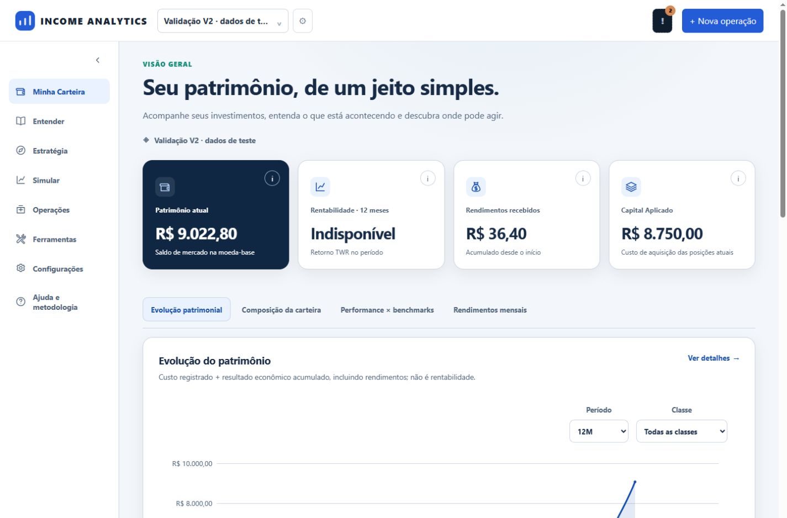
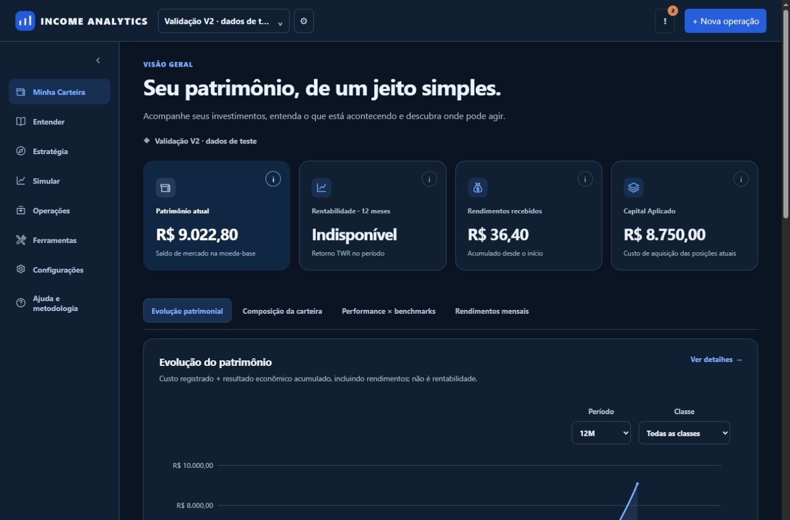
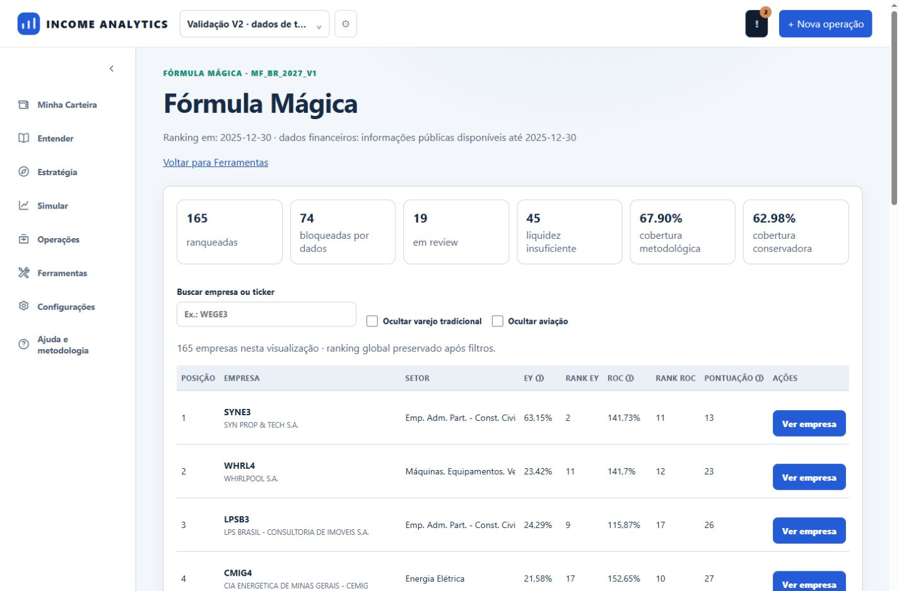
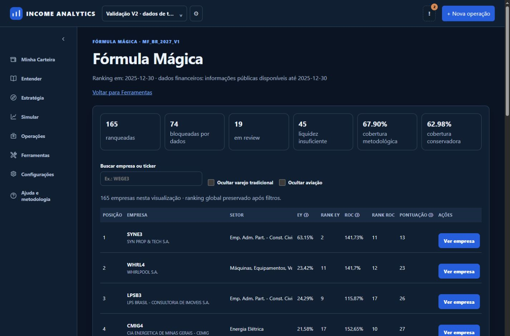
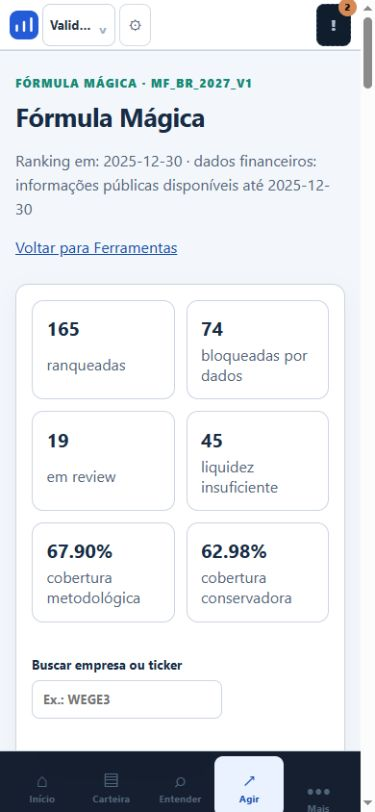

# Identidade visual e restauração do ranking

Complemento independente do PR 3: branch codex/identity-tools-polish, base develop ceb4e81. O PR 3 foi concluído no PR #25, com 71 testes Python mais quatro testes de lançamentos (75 aprovados em execuções separadas), onze scripts Node e evidências próprias em docs/HOLDINGS_V2_PR3.md. Não foi mesclado e PR 4 não foi iniciado.

## Ícones e cores

SVGs do mesmo conjunto, traço 1.7 e currentColor: saquinho de dinheiro para rendimentos, ferramentas cruzadas para Ferramentas, engrenagem para Configurações e interrogação para Ajuda. O logo preserva a base azul e três barras brancas, removendo a linha ascendente que atravessava o símbolo. Nomes acessíveis continuam no controle/link, com SVG decorativo aria-hidden.

Os defaults legados de button, button-link e header-operation usavam um gradiente verde fixo. Agora consomem income-action-bg e income-on-action, com fallback azul/branco. O alias ia-accent também passa a usar a ação azul. Cores semânticas de ganho/perda não foram substituídas. Tokens de texto/superfícies também foram aplicados ao ranking, seus filtros e detalhes nos dois temas; checkboxes não herdam mais largura e altura de campos de texto.

## Causa do ranking

O checkout produtivo isolado não possuía data/magic_formula/canonical_rankings.db e universe_snapshots.db, pois são arquivos externos ao Git. O repositório de ranking utiliza caminhos relativos ao diretório de execução; por isso retornava NO_PUBLISHED_RANKING mesmo com os arquivos publicados existentes na instalação anterior.

Foi criada uma junction local data para o diretório de referência já existente C:/Projetos/income-analytics/data nos checkouts produtivo e de prévia. Nenhum JSON administrativo foi copiado, nenhum ranking foi recalculado ou publicado e nenhum banco financeiro foi alterado. Leitura no contexto do checkout oficial confirmou 165 resultados; SHA-256 do banco de ranking permaneceu idêntico antes e depois dessa leitura. Na prévia HTTP e no navegador: AVAILABLE, 165 empresas, 25 por página.

O procedimento é reproduzível com scripts/connect_income_reference_data.ps1 -ReferenceDataRoot <diretório de referência existente>. O script valida os dois arquivos e nunca substitui um diretório diferente. Deve ser aplicado ao preparar novos checkouts de execução. Requer manter o diretório de referência disponível; não é uma nova fonte de cotações nem uma atualização de dados.

## Validação

- 43 testes de interface e autorização passaram na seleção frontend_modules + firebase_authorization.
- Dez testes de API Magic Formula passaram com a fixture publicada local disponível. Primeira execução isolada registrou sete erros de setup por falta de docs/appendices/magic_formula_v12_2/ranking_snapshot.json (arquivo externo ao checkout). A repetição foi feita a partir da instalação que contém a fixture, com PYTHONPATH apontando para o código desta branch e os testes desta branch por caminho absoluto. O conftest mantém o banco financeiro de testes em SQLite descartável; snapshots gravados pelos testes ficam em tmp_path.
- Scripts Node identity_v2, portfolio_v2 e firebase_account_contrast passaram; sintaxe JS e git diff --check passaram.
- No navegador: ações Explorar azuis, cards/ícones corretos, ranking carregado nos dois temas e 25 cartões mobile sem overflow em 390px. Texto principal #172b46 e secundário #52657b sobre branco no ranking claro, cobertos pelos testes de contraste dos tokens.

A falha de hash certificado preexistente continua registrada no PR 2, sem alterações em motor ou manifesto. A recuperação operacional do diretório de referência já está disponível no serviço atual; o novo visual permanece neste PR, sem merge/publicação automática. A sessão Firebase produtiva não foi recriada para validação de UI: a renderização foi conferida na prévia isolada, e a leitura dos dados no checkout oficial foi conferida separadamente.

## Evidências

