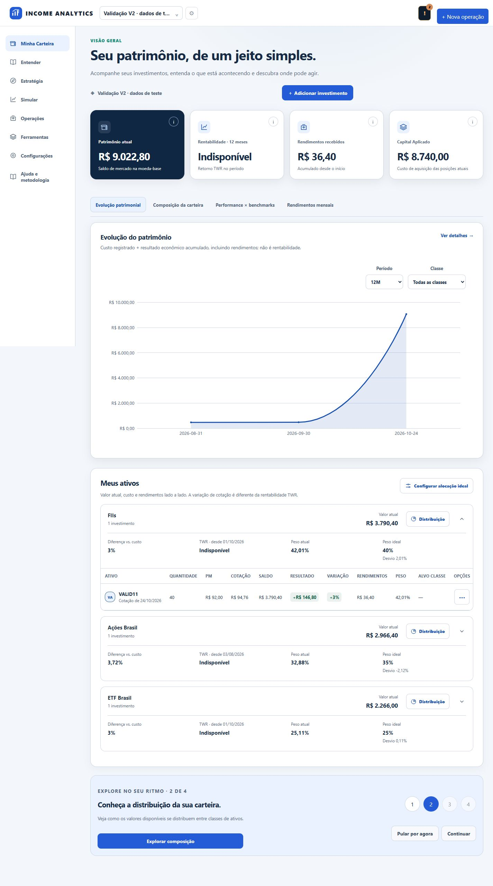
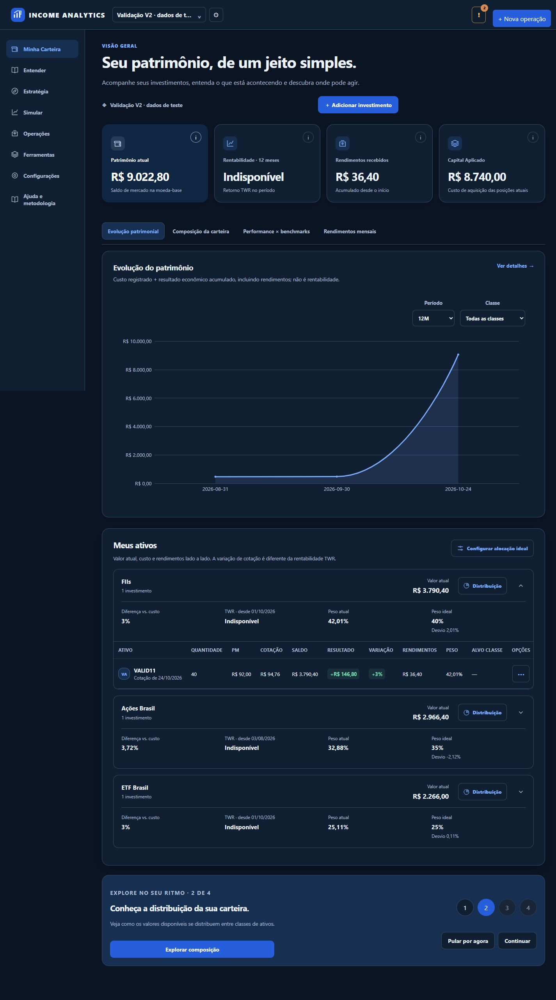
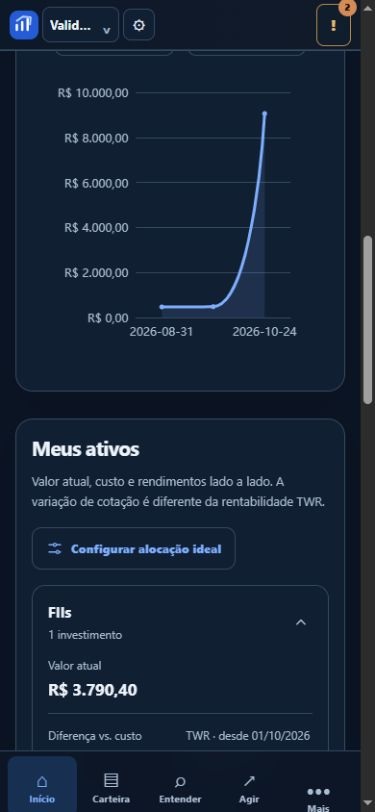
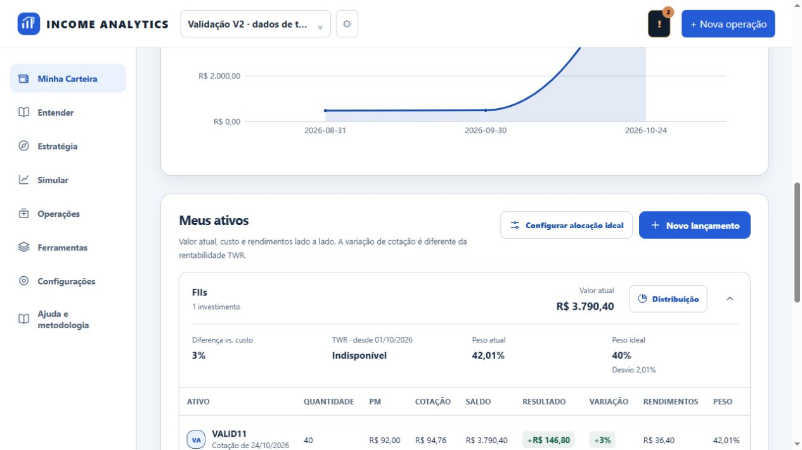
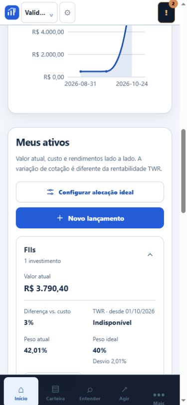
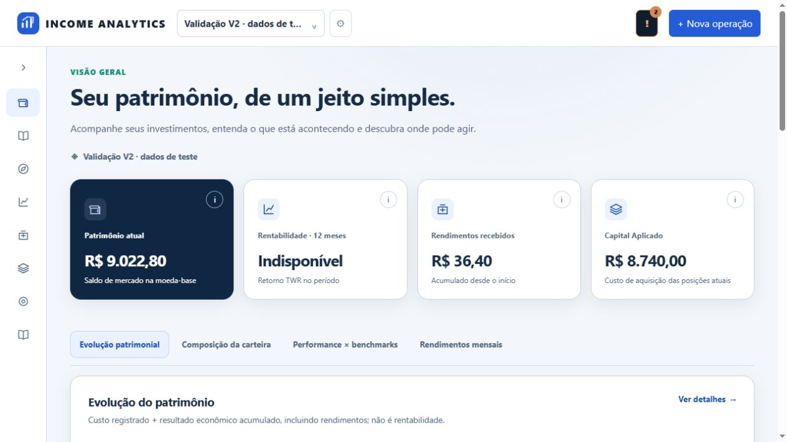

# Refinamento visual de Minha Carteira V2

Decisão de identidade: azul para marca, navegação, links e ações; verde reservado aos resultados financeiros positivos e vermelho aos negativos. O Google mantém seu símbolo multicolorido oficial. Logo Income e controles de autenticação agora acompanham a linguagem azul. Paletas categóricas dos gráficos deixam de usar o verde como primeira cor de destaque; valores e proporções não mudam.

Causas corrigidas:
- O resumo das classes definia cinco colunas para um número variável de elementos, incluindo peso ideal e desvio. A nova estrutura usa áreas nomeadas para classe, valor, distribuição e chevron, e uma linha separada com os indicadores. No mobile, os indicadores usam duas colunas.
- O container #positions conservava o padding de estado vazio mesmo com posições, deslocando as grades. O padding agora pertence ao estado vazio interno, não ao conjunto de ativos.
- A configuração de alocação era inserida entre o título e a descrição. Agora fica em uma barra com o título/descrição e um botão com ícone de ajustes, alinhado à direita no desktop e abaixo do texto no mobile.
- As setas eram caracteres em círculos gerados por pseudo-elementos. Agora são chevrons SVG sem fundo, com rotação discreta, preservando o details/summary nativo e o teclado. Movimento reduzido continua respeitado pelo Design System.
- Tokens legados do tema tinham maior especificidade do que o alias V2, reintroduzindo verde nos controles. html.income-v2 corrige essa prioridade sem alterar cores semânticas de resultado.

Sem mudanças de endpoints, autenticação, ownership, dados, pesos reais, schema, motor financeiro ou hashes certificados. A verificação de pesos definidos usa exclusivamente a carteira identificada de teste em SQLite descartável na porta 8003. Nenhum peso foi alterado no banco pessoal.

Validação: 28 testes de aceitação passaram. Scripts Node alignment, V2/contraste/abas, loading, rendimentos por moeda, XSS, sessão BFF e contraste da conta passaram. No navegador: Enter expande/recolhe, editor de alocação abre, distribuição abre sem fechar o grupo, quatro indicadores mantidos com peso ideal, desktop/mobile e temas claro/escuro. Sem overflow da página em 390px; chevron com fundo transparente; alias de ação escuro resolvido para #7daeff.

| Desktop claro | Desktop escuro |
|---|---|
|  |  |

| Mobile claro | Mobile escuro |
|---|---|
|  |  |

Prévia isolada. Sem merge ou atualização automática do serviço oficial nesta correção.

## Ajuste dos controles e do lançamento

A regra genérica de button aplicava margin-top: 19px à ação do cabeçalho. Os controles do topo agora têm margem zero e altura consistente de 44px. O lançamento saiu da área de boas-vindas e passou para a direita do cabeçalho Meus ativos, ao lado da configuração de alocação e próximo às consolidações. No celular, as duas ações ocupam a largura disponível em linhas separadas.

Novo lançamento abre o mesmo formulário já existente, pelo evento income:open-operation. Não registra dados ao abrir. Validado no navegador em desktop e 390px: controles superiores alinhados na mesma coordenada vertical, formulário abre/fecha, sem overflow horizontal. Testes alignment/loading e 28 testes de aceitação passaram novamente.

## Menu lateral recolhível

Chevron SVG discreto, sem círculo, recolhe a navegação desktop de 218px para 76px e libera 142px para o conteúdo. Os ícones mantêm os nomes acessíveis e os títulos ao passar o mouse; o botão expõe aria-expanded e alterna seu nome entre Recolher/Expandir. A preferência visual é salva localmente e a indisponibilidade do armazenamento não interrompe o menu. Os gráficos são redimensionados após a mudança, sem recarregar dados.

No mobile o controle fica oculto e a navegação existente é preservada. Validação manual: teclado Enter, persistência após reload, SVG do gráfico acompanhando a largura do container e ausência de overflow em desktop/390px. Testes Node cobrem expansão/recolhimento, rótulos, persistência, resize e armazenamento bloqueado; os 28 testes de aceitação passaram.

