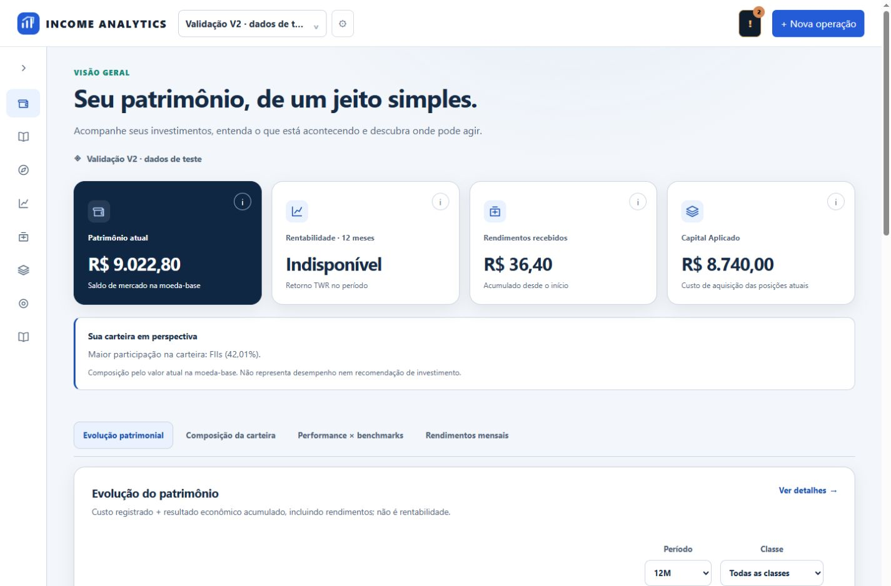
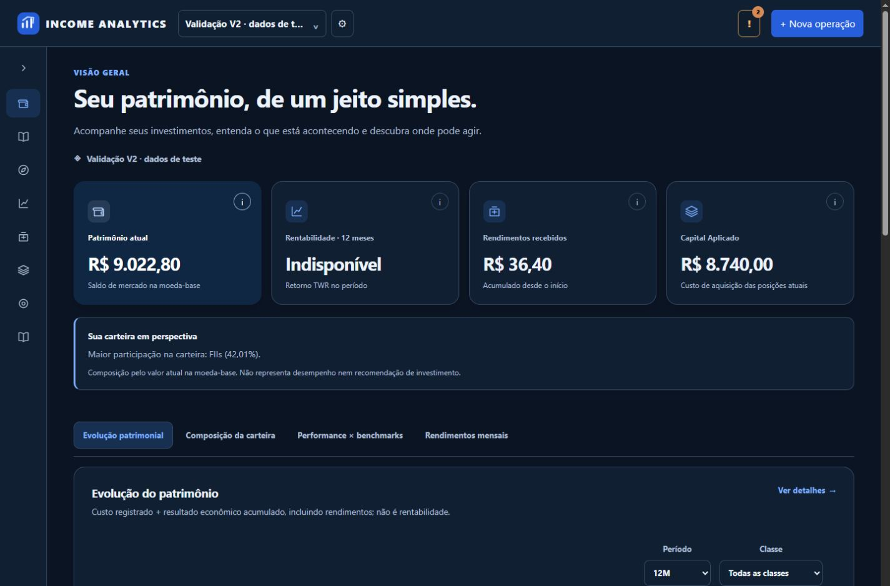
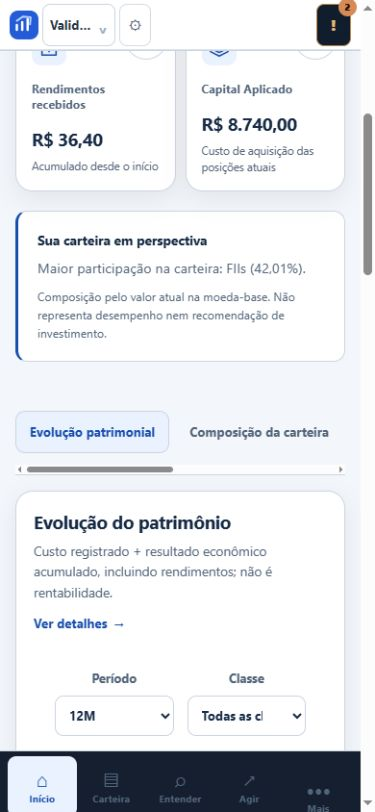
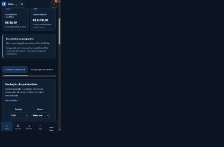

# PR 2 — Complemento da visão patrimonial V2

## Base verificada

Em 24/10/2026, o PR #18 (Design System V2) estava MERGED em develop, branch de origem codex/design-system-v2, merge 5f7d422bc3bb7e44d8370aa843122410fb96b78c. A ancestralidade foi confirmada por git merge-base --is-ancestor. Os testes Node portfolio_v2 validam contraste AA dos tokens, abas persistentes, teclado e toque.

O PR #19 já integrou título, descrição, carteira ativa, cartões com ícones e ajuda, quatro análises e responsividade. Os PRs #22–23 integraram o refinamento visual e o menu recolhível. Este complemento parte de origin/develop a787879, preservando essas entregas, em vez de recriá-las.

## Alterações e componentes

- js/features/portfolio-insights-v2.js: componente de leitura explicativa, usando exclusivamente holdings.classes[].weight fornecido pelo dashboard autorizado. Destaca a maior participação, incluindo empates. Não calcula rentabilidade, diferença de benchmark ou contribuição de ativos. Não adiciona endpoint nem requisição.
- js/features/portfolio-view-v2.js: integra o componente à atualização do dashboard já protegida contra respostas antigas.
- index.html e css/portfolio-v2.css: superfície semântica discreta e responsiva entre cartões e análises. Os textos do read model são inseridos por textContent, sem HTML interpolado.
- js/features/portfolio.js: limpa indicadores e insight ao iniciar uma carga; inclui rendimentos no estado de loading/erro; invalida renderizações assíncronas anteriores dos gráficos. Uma consulta malsucedida não mantém os números da carteira anterior.
- tests/frontend/portfolio_insights_v2.mjs e portfolio_loading_regression.mjs: pesos do backend, avaliação incompleta, empates, classes apenas alvo, texto seguro, imutabilidade e falha ao atualizar carteira.

O insight fica oculto sem avaliação completa, pesos válidos ou posições reais. O percentual é apenas formatado a partir do peso existente. Nenhum resultado indisponível é substituído por zero. Mantidos os quatro indicadores reais: patrimônio de mercado, TWR de 12 meses, rendimentos acumulados e custo das posições atuais (Capital Aplicado). Capital Aplicado não é renomeado como capital líquido investido.

## Verificação

101 testes Python passaram; um teste falhou por condição preexistente. Comando:

```text
py -3.14 -m pytest tests/acceptance/test_frontend_modules.py tests/security/test_firebase_authorization.py tests/security/test_firebase_headers.py tests/security/test_legacy_binding.py tests/application/test_capital_applied.py tests/api/test_portfolio_return_concepts.py tests/acceptance/test_portfolio_performance_mvp.py tests/acceptance/test_portfolio_allocation_mvp.py tests/application/test_historical_shares_units.py -q
```

Dez scripts Node passaram: portfolio_insights_v2, portfolio_alignment, portfolio_v2, portfolio_loading_regression, portfolio_redesign_v1, multiportfolio_context_v2, saas_xss_characterization, firebase_auth_session, firebase_account_contrast e firebase_account_menu. git diff --check passou.

No navegador: desktop 1440×1000 e mobile 390×844, claro e escuro; uma análise visível; filtro 3M preservado ao trocar de aba; SVG do gráfico e container com 261px no mobile; sem overflow horizontal da página. Dados exclusivamente em SQLite descartável, carteira identificada como validação. Acesso produtivo, banco pessoal e configuração Firebase não foram alterados.

## Falha preexistente e limites

O teste test_shares_unit_020_frozen_engine falha com hash de magic_formula_ranking_validation.py: atual 039656c877d516ce2e2cdcf5d6bba7efadf948a92958875ecd140a16349ce83d, esperado 47140198ac099487f4160be411c46ef549a1d3ac3e8db25dbbc672d7133e6a37. Reproduzido separadamente no checkout oficial a787879, sem estas mudanças. Divergência já conhecida de bytes CRLF/LF. Motor e manifesto certificado permanecem intocados.

Não há teste de novo login Google real neste complemento: a autorização usa a matriz de testes com provedor determinístico, e a validação visual é local em banco descartável. Não se afirma certificação financeira integral com esse teste de hash pendente. Não foram adicionados insights de contribuição ou comparação de retorno sem métricas existentes suficientes.

Sem merge automático. Somente o PR 2 foi trabalhado; PR 3 depende da sua validação, seguido do PR 4. O onboarding já existente não equivale ainda a todos os requisitos novos de perfil persistido e conquistas do PR 4.

## Evidências

| Desktop claro | Desktop escuro |
|---|---|
|  |  |

| Mobile claro | Mobile escuro |
|---|---|
|  |  |
