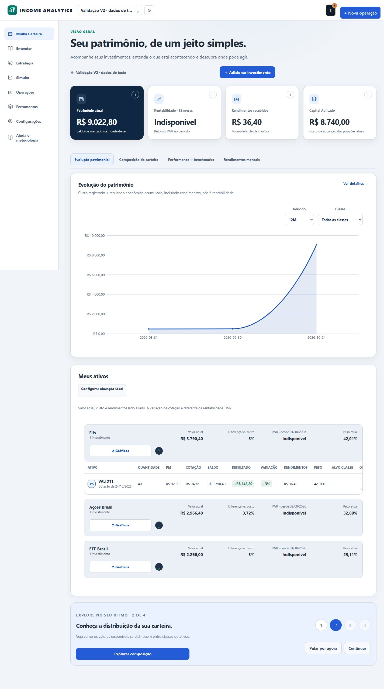
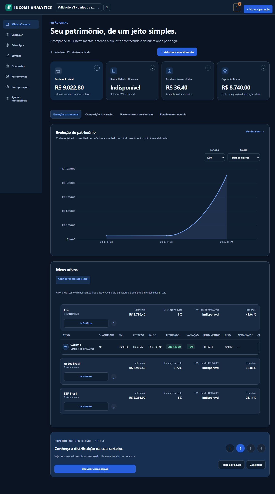
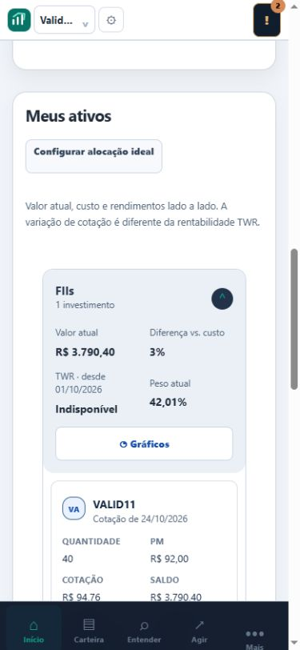

# Minha Carteira V2 — validação e evidências

## Escopo e ambiente

Base oficial develop 39ccc81. Implementação em quatro PRs empilhados, sem merge nem ativação na instância financeira. Banco visual novo em TEMP, servido exclusivamente em 127.0.0.1:8003, com jobs externos desativados. As carteiras e ativos nas capturas são explicitamente de validação; valores foram produzidos pelos endpoints/motor existentes a partir de lançamentos de teste, nunca inseridos diretamente na interface. TWR indisponível é mantido como indisponível.

Auditoria das fontes: [PORTFOLIO_V2_AUDIT.md](PORTFOLIO_V2_AUDIT.md).

## Resultados

- Suíte de segurança/identidade/ownership/interface: **64 aprovados, 5 skipped**. Os cinco casos de integração cloud/emulador exigem opt-in; não foram tratados como aprovação externa.
- Regressão financeira dirigida (TWR, multicurrency, persistência, capital implícito, semântica de retornos, multiportfólio, migrações e cotas históricas): **63 aprovados, 1 falha preexistente**.
- Falha preservada: test_shares_unit_020_frozen_engine, magic_formula_ranking_validation.py, bytes CRLF SHA039656c877d516ce2e2cdcf5d6bba7efadf948a92958875ecd140a16349ce83d versus manifesto LF SHA47140198ac099487f4160be411c46ef549a1d3ac3e8db25dbbc672d7133e6a37. Nenhum arquivo certificado ou manifesto foi alterado.
- Rechecagem de migração/autorização: **18 aprovados**, incluindo proteção contra downgrade que apagaria progresso salvo e preservação das tabelas anteriores. É uma rechecagem parcialmente sobreposta; não somar como casos únicos.
- Scripts Node: portfolio_v2.mjs (AA de tokens, abas persistentes, teclado/swipe e classificação de vazio), portfolio_loading_regression.mjs, portfolio_redesign_v1.mjs (recebimentos por moeda), saas_xss_characterization.mjs e multiportfolio_context_v2.mjs passaram. Sintaxe dos módulos alterados verificada; Ruff e diff --check aprovados.
- Novo teste de autorização confirma persistência do guia, isolamento A/B e entre carteiras do mesmo usuário, rejeição de identidade no body, limite de etapas e payload financeiro idêntico antes/depois.
- Navegador: quatro abas acessíveis, somente um painel visível, filtro 3M preservado após alternância, gráfico de renda inicialmente oculto redimensionado (261px em container de 261px no mobile), troca de tema sem recarga, guia pulado/retomado e recuperado após reload. Tela vazia usa history_boundary.source, pois o backend pode gerar um snapshot zero mesmo sem eventos.
- Inspeção de overflow: viewport 390px, document.scrollWidth 375px (15px reservados ao scrollbar), sem overflow da página; tabelas largas mantêm scroll local no desktop e células rotuladas no mobile. Contraste real do cartão principal claro conferido: branco sobre rgb(16,39,67).

## Migração e implantação

0026_portfolio_onboarding cria apenas metadados de apresentação com chave composta viewer_key/portfolio_id e FK de carteira. Em SaaS, viewer_key vem do usuário autenticado; modo local usa escopo local. Nenhum campo financeiro é migrado, preenchido ou recalculado. Downgrade com progresso salvo é recusado para evitar perda silenciosa. O modo Firebase continua exigindo migração explícita; não iniciar esta branch no banco pessoal sem backup e autorização específicos. A revisão pessoal em uso não foi modificada nesta entrega.

Não mudaram algoritmos, endpoints financeiros, provedores, fontes, históricos, estratégias, Magic Formula, sessão Firebase, ownership ou hashes certificados. O mapa de cores dos eixos é apresentação e responde ao tema. As alterações visuais novas só são ativadas no shell V2; os componentes de autenticação existentes continuam independentes.

## Capturas reais da prévia

| Desktop claro | Desktop escuro |
|---|---|
|  |  |

| Celular claro — 390×844 | Celular escuro — 390×844 |
|---|---|
|  |  |

Estado vazio e detalhe de ativos:

O teste é por viewport no navegador, não certificação de todos os aparelhos físicos. Os resultados acima são suítes dirigidas, não uma declaração de aprovação integral de todo o repositório.
