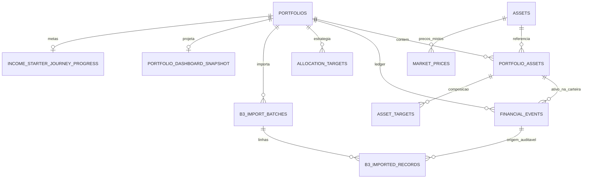

# Inventário de dados — SaaS Multiusuário, Fase 1

Data da coleta: 23/10/2026. Fonte: SQLite aberto com `mode=ro`, `PRAGMA query_only=ON` e uma transação consistente. O script não importa FastAPI/SQLAlchemy e não executa Alembic. Esta evidência contém somente esquema e contagens; não contém nomes/IDs reais de carteiras, saldos, documentos ou tokens.

**35 tabelas efetivas; 30 classes ORM principais; quatro tabelas Magic Formula criadas por SQL específico e `alembic_version`. Revisão: `0023_income_starter_guided_journey`. Integridade: `ok`; violações de FK: 0.** As contagens podem mudar após a coleta por uso normal do servidor.

| Tabela | Linhas na coleta | Classificação | Fronteira atual | Migração / histórico |
|---|---:|---|---|---|
| `alembic_version` | 1 | Infraestrutura | Nenhum | Controla revisão; preservar trilha e bloquear stamp cego. |
| `allocation_targets` | 8 | Privado | portfolio_id + asset_class | Estratégia de classes; manter percentuais e versão sem reconstrução financeira. |
| `asset_economic_exposures` | 0 | Referência/misto | Global por asset_id | Fontes/notas de exposição; só curadoria compartilhada, overrides pessoais separados. |
| `asset_targets` | 54 | Privado | portfolio_id + asset_id | Composição interna por ativos; preservar FKs e objetivos. |
| `assets` | 88 | Misto | Global por ticker | Listados canônicos + ativos particulares; namespace e mutação global precisam ser separados sem trocar IDs. |
| `b3_import_batches` | 8 | Privado | portfolio_id + id | Nome/hash do arquivo, estado e contagens; preservar auditoria e vínculo. |
| `b3_imported_records` | 2286 | Privado | portfolio_id + batch/asset/event | Linhas, instituição e raw_payload; FKs compostas e fingerprint por carteira reaproveitáveis. |
| `benchmark_observations` | 6827 | Referência | Global | Índices com fonte/data; leitura compartilhável, ingestão controlada. |
| `benchmark_rates` | 163 | Referência | Global | Taxas compartilháveis sob licença; escrita restrita ao serviço/curadoria. |
| `company_normalization_validations` | 8 | Referência/QA | Global | Validação de normalização CVM; operação editorial, não dado de carteira. |
| `financial_events` | 1416 | Privado | portfolio_id + id, account_id legado | Ledger fonte de verdade; account_id não é user_id; não reemitir, reordenar ou recalcular. |
| `fixed_income_details` | 18 | Privado | portfolio_id + asset_id | Contratos, emissores e taxas particulares; preservar cada registro e FK composta. |
| `fx_rates` | 1346 | Referência | Global por par/data | Câmbio compartilhável; proibir alteração global arbitrária por usuário comum. |
| `imported_paid_income` | 0 | Privado | portfolio_id + asset_id/event_id | Elegibilidade, quantidade e rendimentos pessoais; deduplicação já inclui carteira. |
| `income_starter_journey_progress` | 1 | Privado | portfolio_id | Despesas essenciais, reserva e progresso: não é catálogo público. |
| `income_starter_template_versions` | 4 | Editorial/referência | Global por template_key/version | Versões, autores e aprovações; publicação exige funções financeira/regulatória distintas. |
| `magic_formula_contract_migrations` | 4 | Infraestrutura/QA | Global, SQL fora do ORM principal | Trilha de versão do contrato MF, distinta do versionamento Alembic. |
| `magic_formula_formal_qa` | 5 | Referência/QA | Global, SQL fora do ORM principal | Gate de qualidade; não expor operações de manutenção a usuários comuns. |
| `magic_formula_fundamentals_snapshots` | 10 | Referência | Global | Dados públicos e proveniência; compartilhar sob licença, manter snapshots. |
| `magic_formula_golden_fixtures` | 5 | Referência/QA | Global, SQL fora do ORM principal | Golden evidence do contrato canônico; preservar hashes e documentos. |
| `magic_formula_issuers` | 5 | Referência | Global, SQL fora do ORM principal | Cadastro canônico de emissores; conservar identificadores e fontes. |
| `market_price_refresh_runs` | 58 | Privado/operacional | portfolio_id | Runs citam ativos da carteira; ocultar detalhes de outros titulares. |
| `market_prices` | 29712 | Misto | Global por asset_id/data | Preços oficiais e manuais/particulares no mesmo armazenamento; inventariar fonte e visibilidade antes de compartilhar. |
| `paid_income_provider_settings` | 0 | Segredo/configuração | Singleton global id=1 | Token em Text sem criptografia no adapter. Definir credencial de plataforma versus chave pessoal; não copiar para todos os usuários. |
| `pension_fund_quotas` | 0 | Referência | Global por fundo/data | Quota pública compartilhável sob licença; não confundir com saldo do plano. |
| `pension_investment_vehicles` | 0 | Privado | portfolio_id + pension_asset_id | Associação do plano pessoal ao fundo público; não publicar o vínculo. |
| `pension_plan_details` | 0 | Privado | portfolio_id + asset_id | Plano, instituição, saldos e origem; preservar histórico e ownership composto. |
| `portfolio_assets` | 88 | Privado | portfolio_id + asset_id | Manter vínculos; autorização deriva do proprietário da carteira. |
| `portfolio_configuration` | 0 | Privado | portfolio_id + key | Preferências financeiras por carteira; manter moeda-base histórica. |
| `portfolio_dashboard_snapshot` | 1 | Privado derivado | portfolio_id | Payload financeiro completo; proteger leitura/status/fila, manter última versão válida. |
| `portfolio_strategy_metadata` | 0 | Privado | portfolio_id | Vínculo e customização de modelo na carteira; preservar versão e fontes. |
| `portfolios` | 2 | Privado | Carteira, sem usuário | Adicionar owner_user_id e vínculo administrativo explícito; UUIDs e linhas preservados. |
| `provider_health` | 18 | Operacional | Global por provider | Métricas globais não são públicas por padrão; mensagens podem conter contexto de consultas. |
| `real_estate_details` | 0 | Privado | portfolio_id + asset_id | Descrição, valor e participação do imóvel; preservar integralmente. |
| `recurring_rules` | 0 | Privado | portfolio_id | Instruções de lançamentos; jobs devem revalidar titular e estado da regra. |

## Relações efetivas



Não existe `USERS -> PORTFOLIOS`. Os vínculos compostos reais abaixo preservam a fronteira de carteira, mas não provam autorização de usuário.

| Tabela dependente | Colunas locais → referências |
|---|---|
| `allocation_targets` | `portfolio_id` → `portfolios.id` |
| `asset_economic_exposures` | `asset_id` → `assets.id` |
| `asset_targets` | `asset_id` → `assets.id`; `portfolio_id` → `portfolio_assets.portfolio_id`; `asset_id` → `portfolio_assets.asset_id`; `portfolio_id` → `portfolios.id` |
| `b3_import_batches` | `portfolio_id` → `portfolios.id` |
| `b3_imported_records` | `financial_event_id` → `financial_events.id`; `batch_id` → `b3_import_batches.id`; `asset_id` → `assets.id`; `portfolio_id` → `b3_import_batches.portfolio_id`; `batch_id` → `b3_import_batches.id`; `portfolio_id` → `portfolio_assets.portfolio_id`; `asset_id` → `portfolio_assets.asset_id`; `portfolio_id` → `financial_events.portfolio_id`; `financial_event_id` → `financial_events.id`; `portfolio_id` → `portfolios.id` |
| `financial_events` | `asset_id` → `assets.id`; `portfolio_id` → `portfolios.id`; `portfolio_id` → `portfolio_assets.portfolio_id`; `asset_id` → `portfolio_assets.asset_id` |
| `fixed_income_details` | `asset_id` → `assets.id`; `portfolio_id` → `portfolio_assets.portfolio_id`; `asset_id` → `portfolio_assets.asset_id`; `portfolio_id` → `portfolios.id` |
| `imported_paid_income` | `asset_id` → `assets.id`; `financial_event_id` → `financial_events.id`; `portfolio_id` → `financial_events.portfolio_id`; `financial_event_id` → `financial_events.id`; `portfolio_id` → `portfolios.id`; `portfolio_id` → `portfolio_assets.portfolio_id`; `asset_id` → `portfolio_assets.asset_id` |
| `income_starter_journey_progress` | `portfolio_id` → `portfolios.id` |
| `magic_formula_contract_migrations` | `snapshot_id` → `magic_formula_fundamentals_snapshots.id` |
| `magic_formula_formal_qa` | `fixture_hash` → `magic_formula_golden_fixtures.None`; `issuer_id` → `magic_formula_issuers.None`; `snapshot_id` → `magic_formula_fundamentals_snapshots.id` |
| `magic_formula_golden_fixtures` | `issuer_id` → `magic_formula_issuers.None` |
| `market_price_refresh_runs` | `portfolio_id` → `portfolios.id` |
| `market_prices` | `asset_id` → `assets.id` |
| `pension_investment_vehicles` | `pension_asset_id` → `assets.id`; `portfolio_id` → `portfolio_assets.portfolio_id`; `pension_asset_id` → `portfolio_assets.asset_id`; `portfolio_id` → `portfolios.id` |
| `pension_plan_details` | `asset_id` → `assets.id`; `portfolio_id` → `portfolio_assets.portfolio_id`; `asset_id` → `portfolio_assets.asset_id`; `portfolio_id` → `portfolios.id` |
| `portfolio_assets` | `asset_id` → `assets.id`; `portfolio_id` → `portfolios.id` |
| `portfolio_configuration` | `portfolio_id` → `portfolios.id` |
| `portfolio_dashboard_snapshot` | `portfolio_id` → `portfolios.id` |
| `portfolio_strategy_metadata` | `portfolio_id` → `portfolios.id` |
| `real_estate_details` | `asset_id` → `assets.id`; `portfolio_id` → `portfolio_assets.portfolio_id`; `asset_id` → `portfolio_assets.asset_id`; `portfolio_id` → `portfolios.id` |
| `recurring_rules` | `asset_id` → `assets.id`; `portfolio_id` → `portfolio_assets.portfolio_id`; `asset_id` → `portfolio_assets.asset_id`; `portfolio_id` → `portfolios.id` |

## Conceitos não persistidos como entidade independente

- Usuários, identidades externas, sessões, recuperação, papéis administrativos, assinaturas, entitlements e consentimentos bancários: **não encontrados**.
- Posições e patrimônio: projetados do ledger e preços; não existe tabela de posições a reconstruir para introduzir usuários.
- Simulação de aporte: projeção não persistente (`project_hypothetical_contribution`); não há tabela de cenários privados salvos hoje.
- Histórico financeiro: `financial_events` e observações/preços; snapshots de dashboard são derivados e não substituem o ledger.
- Metas: despesas/reserva na jornada persistida; não foi encontrada uma entidade genérica de metas multiusuário.
- Tema e carteira selecionada: `localStorage` no navegador, por carteira; falta namespace por usuário/logout. Não armazenam uma identidade autenticada.
- Exportação de conta/relatórios baixáveis: nenhuma rota dedicada encontrada no inventário atual. As APIs JSON já contêm informação privada e exigem autorização; a inexistência de download não elimina o risco.
- Arquivos B3/IRPF: upload base64 processado em memória; B3 conserva linhas/raw_payload e auditoria no banco. Cache COTAHIST em disco é de fonte pública e não é uma pasta de importações privadas.

## Reprodução

```powershell
py -3.14 scripts/audit_saas_architecture.py --database income_analytics.db --output "$env:TEMP\income-saas-inventory.json"
```

Guardar evidência operacional detalhada e eventual manifesto de vinculação em armazenamento administrativo privado, fora do Git. O inventário não identifica nem confirma quem é a pessoa proprietária das duas carteiras encontradas.
