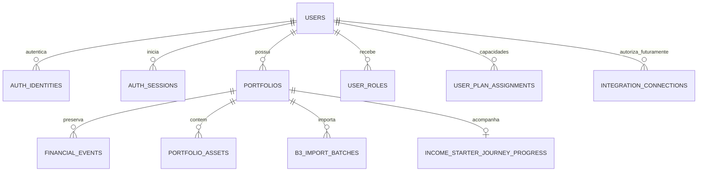

# Plano de implementação SaaS multiusuário — Income Free + Pro

**Fase 1, 23/10/2026. Estado: desenho proposto, sem autenticação/migração aplicada e sem fornecedor contratado.** Este plano parte da [auditoria real](SAAS_MULTIUSER_ARCHITECTURE_AUDIT.md), das [35 tabelas](SAAS_MULTIUSER_DATA_INVENTORY.md) e das [96 rotas](SAAS_MULTIUSER_ENDPOINT_INVENTORY.md). Não é uma declaração de que os controles abaixo já existam.

## 1. Decisões antes de ativar autenticação e migrar titularidade

| ADR | Decisão pendente | Proposta para avaliação | Consequência de implementar sem resolver |
|---|---|---|---|
| ADR-01 | IdP, região, orçamento, e-mail, MFA de staff, revogação e portabilidade | Identidade gerenciada; comparar Supabase Auth/Auth0 e a alternativa Clerk; Keycloak se houver capacidade operacional. BFF de mesma origem é a proposta para o frontend atual | Prender FKs ao fornecedor, criar login inseguro ou assumir sem prova que uma sessão/cookie é revogável/HttpOnly |
| ADR-02 | Separação de ativo/preço canônico e particular | Manter IDs/ledger; só serviço/curadoria altera referência global; overrides privados e namespace por carteira quando necessário | Um usuário altera a classificação/cotação usada por outro, mesmo depois de adicionar owner_user_id |
| ADR-03 | Procedimento de confirmação do proprietário dos dados legados e critérios de corte | Manifesto administrativo privado, dry-run, identidade confirmada e trilha de auditoria; nenhum primeiro-login automático | Atribuir carteiras reais à conta errada |
| ADR-04 | Credenciais comerciais de mercado: plataforma versus BYO key | Plataforma em secret manager com quotas; se BYO, segredo privado por usuário. Tokens bancários sempre por titular/consentimento | Copiar token legado global para usuários, misturar custos e concessões de acesso |
| ADR-05 | Gate de certificação, baseline Git limpo e implantação/migrador | Resolver divergência documentada de bytes LF/CRLF no processo de certificação; integrar/rebasear as mudanças locais auditadas antes de criar a sequência SaaS | Declarar hashes verdes sem prova, migrar um baseline diferente do auditado ou executar DDL automático em todos os workers |

Essas decisões estão apresentadas, não aprovadas. As fundações neutras e inativas podem ser revisadas sem escolher IdP. Os ADRs continuam obrigatórios antes de ativar login, cadastro, autorização pública e vínculo legado. Nenhuma migração foi executada na instalação local.

## 2. Identidade interna e modelo de dados proposto

### 2.1 Identidade humana

`users`: `user_id UUID PK`, `email`, `email_verified_at`, `status`, `created_at`, `updated_at`. O UUID é gerado internamente e nunca muda ao trocar de IdP/e-mail/plano. E-mail não é FK financeira. Normalização/uniqueness de e-mail e política para endereços alterados ficam explícitas no ADR; não juntar contas apenas porque enviaram o mesmo e-mail.

`auth_identities`: `identity_id`, `user_id FK`, `issuer`, `subject`, timestamps e `UNIQUE(issuer, subject)`. Somente resultado verificado pelo adaptador de identidade pode criar/ligar esse registro. Claims do navegador e `user_id` de body/header não participam da decisão. Vincular uma segunda identidade exige reautenticação e política explícita contra tomada de conta.

`auth_sessions` (se BFF aprovado): `session_id_hash`, `user_id`, referência de identidade/provedor, `created_at`, `expires_at`, `revoked_at`, `session_version`, metadados mínimos de segurança. Cookie contém identificador opaco aleatório; nunca senha nem informações financeiras. Tokens de refresh só se necessários, protegidos pelo mecanismo de segredos aprovado. Bibliotecas mantidas/SDK oficial; nenhuma criptografia própria.

Estados de conta (`ACTIVE`, `SUSPENDED`, `DELETION_PENDING`, por exemplo) são distintos de estados comerciais. Conta suspensa ou sessão revogada não é reativada por mudar `plan` no frontend.

### 2.2 Propriedade de carteira

Adicionar `portfolios.owner_user_id -> users.user_id`. Relação final `User 1:N Portfolio`; sem compartilhamento/membership de carteira na primeira versão. Usar FK e índice por proprietário; manter `portfolios.id` e todos os `portfolio_id` existentes.

Na fase de expansão, owner pode ser `NULL` somente para legado **quarentenado/inacessível pelo modo SaaS**. Contas novas só criam carteiras com owner derivado do principal autenticado. Depois de resolver todo o legado, avaliar NOT NULL em migração separada. Um cadastro público não executa backfill nem “assume” MAIN.

`SqlitePortfolioRepository` passa a oferecer `list_owned(user_id)`, `get_owned(user_id, portfolio_id)` e escritas com owner interno. `_ensure_unique_name` em `api/routers/portfolios.py` passa a avaliar nome por usuário; o escaneamento atual de todas as carteiras pode revelar conflitos de terceiros. Reaplicar a regra ao restaurar carteiras arquivadas. Não incluir owner em `PortfolioCreate`/`PortfolioUpdate` público.

Os dependentes continuam com `portfolio_id`, FKs compostas e fonte de verdade atual. Não replicar `user_id` em cada evento sem necessidade: isso cria uma segunda propriedade que pode divergir da carteira. Consultas por evento/ativo/lote resolvem o owner por join/escopo autorizado, não por conhecimento do UUID.

### 2.3 Outras entidades novas, por incremento

| Modelo proposto | Fronteira e campos centrais | Observação |
|---|---|---|
| `user_roles`/grants | usuário, função, escopo, concedente e validade | Roles operacionais/editoriais; não concedem leitura universal das carteiras |
| `user_plan_assignments` | usuário, plano, status comercial, origem da concessão e validade | Free pode ser calculado como default sem registro de assinatura; não simular transação paga |
| `admin_audit_events` | ator, ação, tipo/ID de recurso, resultado, motivo, timestamp/correlação | Registro protegido, sem payload financeiro/segredo |
| `legacy_ownership_claims` | referência de manifesto, carteira, destino, verificador, estado e timestamps | Só ferramenta administrativa; confirmação explícita, não endpoint de onboarding |
| `integration_connections` (futuro) | owner, provedor, instituição, external_account_id, consentimento, estado, secret_ref, última sincronização | Sem token plaintext, sem conector bancário ativo nesta fase |
| `sync_runs`, `reconciliation_items` (futuro) | owner/conexão/carteira, cursor, status, dedupe key, resultado e correlação | Idempotência e proveniência; erros não expõem dados de outro usuário |
| `usage_events`/agregados | usuário/serviço, recurso técnico, custo estimado, quantidade e período | Sem posições/saldos nas métricas; não representa cobrança |

Configurações pessoais migram para namespace de usuário; moeda-base, alvos e preferências financeiras da carteira mantêm escopo por carteira. Tema pode continuar local como preferência visual, com namespace `user_id/portfolio_id` e limpeza no logout.



## 3. Fluxo de autenticação proposto

1. O visitante acessa somente shell, saúde mínima, políticas e endpoints explicitamente públicos. A allowlist não inclui APIs de patrimônio por prefixo ou por conveniência.
2. Cadastro/login ocorrem pela solução aprovada. Para fluxo OIDC, usar Authorization Code + PKCE e validação de `state`, `nonce`, assinatura, algoritmo permitido, `issuer`, `audience`, expiração e demais claims exigidos pelo fluxo. Não aceitar token apenas decodificado nem ID token como access token fora do contrato correto.
3. Callback valida a prova com biblioteca mantida, resolve `(issuer, subject)` para UUID interno e consulta status da conta. E-mail não verificado recebe somente o fluxo mínimo de verificação/conta até cumprir a política de acesso financeiro.
4. Se adotado BFF, emitir cookie `Secure`, `HttpOnly`, `SameSite=Lax`, escopo de host/path deliberado, com rotação/expiração. Operações unsafe exigem proteção CSRF explícita e validação de origem; SameSite sozinho não é política completa.
5. Logout revoga a sessão local e a do IdP conforme capacidades documentadas; invalidar todas as sessões ao bloquear a conta/revogar credenciais. Requisições subsequentes são rejeitadas mesmo se o navegador conservar um cookie antigo.
6. Recuperação/verificação não expõem se determinada conta existe; tokens curtos e uso único são responsabilidade do IdP/SDK adequado. Aplicar limites por identidade/origem, sem confiar apenas em IP compartilhado.

Novos módulos propostos: `application/identity.py` (Principal/port de IdP), `application/authorization.py` (política), `api/dependencies/authentication.py`, `api/dependencies/portfolios.py`, `api/routers/auth.py` e adapter do fornecedor escolhido. Nomes indicam trabalho futuro; não são arquivos já implementados por esta auditoria.

O HTTP da instalação pessoal/Tailscale atual não é a implantação de sessão SaaS pública. O deployment público exige origem HTTPS e configuração de proxy/host explícita, sem fallback automático para modo local caso faltem segredos do IdP.

## 4. Política de autorização: backend e negação padrão

### 4.1 Ordem do request

`verificar sessão -> carregar Principal -> verificar conta/e-mail -> validar seletor -> consultar carteira do titular -> verificar ação/capacidade -> construir contexto de domínio`.

O atual `X-Portfolio-Id` pode continuar como seletor técnico, mas não como prova. Em SaaS não existe fallback financeiro para MAIN. Rotas de conta/lista não exigem carteira selecionada, mas exigem usuário; rotas de patrimônio exigem ambos. Rejeitar anônimo com 401 antes de consultar recursos privados. Para UUID válido não pertencente ao titular, usar 404 sem revelar nome, saldo ou existência. Preservar o 409 de escrita em carteira arquivada **após** verificar propriedade.

Não é suficiente adicionar um guard só a `get_portfolio`. Proteger também dashboard/status/rebuild, eventos, alvos, simulações POST, configurações, receitas, lotes e aliases `/imports/b3/*`.

### 4.2 Serviços e repositórios

- Produzir um `AuthorizedPortfolio` imutável no backend a partir de Principal + consulta de owner; não deserializar esse tipo do navegador.
- `PortfolioSession` e adapters privados recebem somente contexto autorizado. Remover fallback implícito MAIN do caminho SaaS em `_PortfolioSessionProxy._target` e `current_portfolio_id`; jobs usam contexto de serviço explícito.
- `main.py` deve autenticar e conferir ownership antes dos fast paths de snapshot/status. Evitar construir a sessão financeira em leitura de metadados, mantendo o ganho de performance existente.
- `portfolio_assets` continua evitando transação com ativo particular de outra carteira; isso complementa, mas não substitui, propriedade humana.
- Ao ler/excluir evento por ID, consultar evento + carteira autorizada; ao aplicar importação, lote + owner + carteira + estado. `file_hash`, fingerprint ou ID de job não são credenciais.
- Account/session/plan/owner enviados em body, query ou flags do browser são ignorados/rejeitados; alterações privilegiadas só em comandos internos auditados.
- Gate automático de novas rotas: todo endpoint recebe política declarada; se não houver política, negar. Teste de cobertura percorre a tabela de rotas e todos os métodos/aliases.

Essas medidas seguem os princípios de menor privilégio, negação padrão e checagem a cada request da [OWASP Authorization Cheat Sheet](https://cheatsheetseries.owasp.org/cheatsheets/Authorization_Cheat_Sheet.html).

### 4.3 Papéis separados

| Papel | Permitido | Não concedido automaticamente |
|---|---|---|
| Usuário | Seus dados/carteiras e funcionalidades do plano | Dados alheios, plano/owner arbitrário, escrita em mercado canônico |
| Administrador operacional | Estado de serviços/contas, quotas e suporte com metadados mínimos | Conteúdo de carteira, execução de operações particulares, aprovação financeira/regulatória |
| Aprovador financeiro | Proposta e evidência financeira de template | Aprovação regulatória, bypass de DRAFT, leitura global de patrimônios |
| Aprovador regulatório | Revisão e evidência regulatória de template | Aprovação financeira, acesso geral a segredos ou dados particulares |
| Publicador editorial | Publicar somente versão aprovada pelos gates e conforme separação de funções definida | Inventar percentuais, alterar a proposta aprovada ou atuar como dono de todas as carteiras |
| Principal de serviço | Ação técnica explicitamente delegada e limitada ao job | Acesso irrestrito só por estar num worker ou por portar portfolio_id |

Não implementar carteira compartilhada/membership colaborativa nesta primeira versão. Alteração de owner não entra na API comum.

## 5. Plano Free/Pro e entitlements

O plano controla **capacidades**, nunca a propriedade ou a possibilidade de recuperar os próprios dados. Usuário autenticado sem assinatura paga tem plano efetivo `FREE`. O plano recebido do frontend não é consultado como autoridade.

| Capacidade estável proposta | FREE | PRO | Disponibilidade inicial |
|---|---|---|---|
| `manual_records` | Sim | Sim | Usar endpoints e validações existentes |
| `multiple_portfolios` | Sim | Sim | Sem limite artificial de uma carteira |
| `wealth_analytics` | Sim | Sim | Reaproveitar motor certificado |
| `benchmarks` | Sim | Sim | Compartilhar referências conforme licença/custo |
| `allocation_strategies` | Sim | Sim | Políticas existentes, com owner |
| `income_starter` | Sim | Sim | Gates editoriais e DRAFT preservados |
| `simulations` | Sim | Sim | Projeções existentes, sem gravar operação real |
| `manual_imports` | Sim | Sim | B3/IRPF existentes e quotas técnicas |
| `reports_and_export` | Sim | Sim | Relatórios existentes; novo export de conta quando implementado |
| `bank_connections` | Não | Futuro | Flag global fechada, mesmo para concessão PRO |
| `automatic_account_sync` | Não | Futuro | Sem conector/falso botão operacional |
| `automatic_reconciliation` | Não | Futuro | Só contrato/estados e testes de negação |

`PlanCode = FREE | PRO`; estados comerciais futuros `ACTIVE | TRIALING | PAST_DUE | CANCELED`. Nesta fase, não criar cobrança, cartões, webhooks de pagamento ou linhas que finjam assinatura paga. Atribuição administrativa de capacidade para testes não é assinatura real e precisa de origem/expiração auditáveis.

Resolução proposta: conta válida + atribuição server-side válida + estado comercial que conceda capacidade + feature flag de disponibilidade. Feature desconhecida nega. PRO cancelado/inativo cai no conjunto Free, preservando leitura, edição manual e recuperação dos dados próprios; o conjunto preciso de automações suspensas será definido antes de comercializá-lo.

`application/entitlements.py` deve ser um serviço de política central, com checks backend nas ações correspondentes e API de capacidades somente para apresentação. Não espalhar `if plan == 'PRO'` em componentes ou aceitar um `is_pro` do navegador.

A sincronização BRAPI de proventos que já existe **não é conexão bancária/Open Finance**. Seu enquadramento/licença e quem detém a chave precisam ser decididos no ADR-04; não remover uma funcionalidade atual nem anunciar conexão institucional por renomear esse adapter. Importação manual continua distinta da automação futura.

Quotas técnicas: frequência de refresh, custo por provedor, tamanho/descompressão de upload, páginas/linhas por lote, concorrência de rebuild e export. São controles de abuso/custo aplicados de forma documentada; não um bloqueio arbitrário de poucos ativos/carteiras no Free.

## 6. Migração com preservação integral

### 6.1 Preparação e baseline

1. Identificar todas as carteiras e dependentes com o coletor somente leitura; confirmar revisão, integridade, FKs, órfãos e tabelas fora do ORM. A coleta inicial tem duas carteiras e 1.416 eventos, mas o manifesto de corte deve ser novo e consistente.
2. Suspender escritas e jobs durante o corte. Capturar backup consistente via API SQLite de backup ou mecanismo transacional apropriado, incluindo WAL quando aplicável. Cifrar/restringir acesso a backups e testar restauração numa cópia.
3. Guardar fora do Git um manifesto de contagens, IDs e hashes de ledger/importações/estratégias/metas, sem expor nomes, quantidades ou credenciais em logs públicos. Preservar eventos, timestamps, IDs, fingerprints, versões e fontes exatamente.
4. Registrar outputs dourados em cópia isolada, mesma versão de código, `as_of`, preços/câmbio e provedores congelados. Separar metadados não financeiros variáveis com regra documentada, sem excluir campos financeiros para fazer testes passarem. Não reescrever manifesto certificado.
5. Fechar ADR-03 com comprovação do titular e aprovação do manifesto de vínculo. **Não usar “primeiro usuário”, endereço do dispositivo, nome da carteira ou MAIN como prova de titularidade.**

### 6.2 Expandir, reivindicar e contrair

- Migração Alembic de expansão cria usuários/mapeamentos/auditoria e owner nullable, sem backfill arbitrário. Ensaiar upgrade de cópia do banco real e de banco vazio; preservar as tabelas não-ORM de Magic Formula.
- Carteiras legadas continuam no mapa de exceções administrativas; não aparecem em lista/onboarding público e não podem ser selecionadas por header no modo SaaS.
- Comando administrativo proposto `link-legacy-owner` recebe manifesto assinado/revisado, UUIDs internos, identificador da evidência e operador. `--dry-run` deve ser a primeira ação. Esse comando ainda não existe e não deve ser substituído por SQL manual sem auditoria.
- Aplicação transacional: verificar que carteiras continuam sem owner, que hashes/contagens não mudaram e que usuário de destino está verificado. Escrever apenas owner e trilha de vínculo, mantendo todos os IDs dependentes. Falha faz rollback total. Reexecução idêntica é no-op; tentativa de reatribuição a outro usuário é rejeitada e auditada.
- Resolver ativos/preços de natureza mista conforme ADR-02 sem mudar UUIDs de eventos/ativos. Se houver ambiguidade sobre preço manual compartilhado, bloquear a promoção dessa referência até confirmação administrativa; não qualificá-la como dado público por estar na tabela global.
- Após testes de acesso cruzado e equivalência, promover leitura/rotas com owner. Só então considerar owner NOT NULL ou exclusão definitiva da compatibilidade local em uma migração de contração separada.

A expansão é compatível com Alembic e reexecutável via revisão/guards próprios. O serviço SaaS não roda DDL ou `stamp(head)` em cada web worker; migrações são um passo controlado de deploy. Não fazer downgrade da revisão 0019 para introduzir User.

### 6.3 Rollback

Antes de permitir novas escritas, falha de migração permite restaurar a cópia consistente sob janela de manutenção. Depois de aceitar dados SaaS novos, não restaurar cegamente um backup antigo nem dropar tabelas de usuários: isso apagaria operações recentes. Desativar acesso público, suspender writers, preservar o estado e os novos eventos, produzir delta auditável e executar reparo/rollback revisado. Testar esses dois cenários em rehearsal.

O plano não recalcula nem reemite o histórico financeiro no banco real. A comparação de cálculos é uma leitura de regressão numa cópia. Certificação da migração só pode ser marcada PASS após o ensaio e os gates correspondentes.

## 7. Mercado compartilhado, arquivos, caches e jobs

- Separar catálogo canônico/licenciado de nomes/classificações/valores particulares. Na transição, `assets` e `market_prices` exigem tratamento de dados mistos; o inventário registra isso explicitamente.
- Público/shared: snapshots MF, benchmarks, FX e cotações oficiais podem usar cache global conforme contrato. A escrita canônica exige principal de ingestão/curadoria, idempotência e proveniência.
- Privado: cache key inclui recurso/carteira e revisão de owner quando aplicável; autorização ocorre antes de ler cache. Não reutilizar caches de browser após logout/troca de usuário. Troca de owner invalida caches e trabalhos pendentes.
- Jobs de patrimônio, recorrências e imports recebem owner e carteira de uma fila confiável, validam o vínculo no início e antes do commit. Isolar contexto Python com reset em finally. Separar limites de serviço de limites do usuário.
- A fila de dashboard atual é adequada ao processo local, mas SaaS multiprocesso exige lock/lease/revisão durável e recuperação de jobs. Banco de jobs/worker ou fila gerenciada é decisão de deployment, não alteração de TWR.
- Uploads privados: caminho/chave opaca com namespace owner/carteira, sem nome do arquivo como caminho; armazenamento fora do static mount, TTL, checksum, limites e ACL. Downloads/URLs assinadas têm escopo e expiração; URL difícil de adivinhar não substitui permissão.
- Imports B3/IRPF mantêm auditabilidade/dedup por carteira. COTAHIST público não compartilha pasta com upload privado. Remover aliases antigos ou protegê-los pela mesma política antes da publicação.

## 8. Contrato futuro de integração Pro

Preparar interfaces e modelo de estados, sem implementar bancos, conectar instituição, simular login de banco ou contratar agregador.

Port proposto `InstitutionProvider`:

- iniciar autorização/consentimento com redirect/state verificados;
- obter estado de conexão e escopos autorizados;
- obter contas/posições/transações paginadas por cursor;
- revogar conexão/consentimento e eliminar referências de segredo conforme retenção;
- normalizar erro recuperável, rate limit, credencial revogada e indisponibilidade.

O adapter devolve dados externos com IDs/proveniência, não comandos financeiros executados. `Connection` carrega owner, instituição/provedor, consentimento/validade, `secret_ref`, identificador externo opaco, estado e última sincronização. Um segredo de usuário nunca é reutilizado em outro owner.

Antes de materializar um evento, reconciliação/idempotência valida `(owner, connection, external_account, provider_transaction_id)` e o mapeamento da conta externa para uma carteira do mesmo owner. Proteger contra retries, eventos fora de ordem, correções, duplicidade manual versus importada e webhooks falsos. Usar as regras existentes de importação/ledger quando compatíveis, sem alterar fórmulas nem inserir eventos fictícios.

Estados de UI: não disponível, autorização pendente, conectado, sincronizando, exige reconexão, revogado, falhou. Nenhum estado “conectado” sem autorização real. Nesta fase, flags dessas ações continuam fechadas para FREE e PRO, independentemente de grants de teste.

## 9. Segurança de implantação e privacidade

Gate de lançamento exige HTTPS, host/proxy confiáveis, cookies e CSRF conforme arquitetura, proteção de sinks HTML/tooltips, CSP, limites de API/upload/login e logs redigidos. Uma busca por `.env`/nomes de variáveis não substitui secret scanning da história Git, CI e containers. Logs não devem incluir Authorization, cookie, token do provedor, conteúdo de importação ou payload financeiro individual.

Exigir MFA e contas individuais para staff, concessões mínimas, ações privilegiadas auditadas e procedimento de incidente com revogação/contensão/registro. Configurar retenção de backups/temporários/logs e testar exclusão/exportação autorizadas de conta; a limpeza atual da carteira não cobre a jornada/metadata de estratégia nem é uma política completa de conta.

O desenho deve mapear finalidade, dados, operadores/suboperadores, transparência, pedidos do titular, portabilidade/exclusão e eventual retenção obrigatória. Prazo e base jurídica não são inventados aqui: precisam de validação para a operação e contratos escolhidos. Referência de medidas de segurança: [guia oficial ANPD](https://www.gov.br/anpd/pt-br/centrais-de-conteudo/materiais-educativos-e-publicacoes/guia-orientativo-sobre-seguranca-da-informacao-para-agentes-de-tratamento-de-pequeno-porte).

## 10. Matriz de segurança a implementar

Fixture futura: usuário A verificado com A1/A2 e usuário B verificado com B1/B2; principal anônimo, token inválido/expirado, usuário suspenso, admin operacional e aprovadores separados. Até existir essa infraestrutura, os probes atuais usam dois clientes anônimos; não são falsamente apresentados como testes de dois usuários autenticados.

| # | Cenário obrigatório | Evidência atual | Expectativa e ponto de teste futuro |
|---|---|---|---|
| 1 | A consulta carteira B | Falta de auth reproduzida; UUID B basta | 404 para A; listagem contém só A1/A2; `portfolios.py` e read paths |
| 2 | A altera operação B | Escrita por header B reproduzida | Nenhuma escrita e 404; testar POST, PATCH/PUT e IDs indiretos |
| 3 | A exclui dados B | DELETE com header B reproduzido; carteira A bloqueia ID B | Negar DELETE/reset/archive de B; comparação de contagens/hashes antes/depois |
| 4 | A acessa estratégia B | Consulta/alteração de política com header B reproduzidas | Negar análises, alvos e metadados de B; manter gates Starter |
| 5 | A consulta simulação B | POST analítico sem login aceita carteira B | 404/401; simulação não grava ledger nem vaza posições |
| 6 | A exporta B | Sem rota dedicada; JSON financeiro já acessível | Testar APIs atuais; futuros exports não podem criar job/download para B |
| 7 | A acessa importação B | Escopo de carteira em B3 existe, ownership não | Negar preview/apply/history e aliases com owner errado; URL/ID não é autorização |
| 8 | A altera plano B | Não existe plano/endpoint hoje | Cliente comum não concede plano, `is_pro`/user_id forjados rejeitados; grant só auditado |
| 9 | Anônimo usa rota privada | Aceitação sem autenticação confirmada | 401 para todos os métodos/rotas privados, inclusive status/rebuild e aliases |
| 10 | Manipulação de portfolio_id | Bypass por header demonstrado | Contexto só por owner; UUID válido/ausente/invalidado não contorna proteção |
| 11 | Jobs/caches misturam dados | Chave por carteira e testes locais existentes; sem owner de job | A/B concorrentes, logout, suspensão, reatribuição e worker retry sem vazamento; testar multiprocesso |
| 12 | Free acessa Pro | Não há entitlements; Pro não implementado | Capacidades futuras negadas até flag + entitlement server-side; frontend não concede acesso |
| 13 | Referência de mercado compartilhada | Estrutura global existente, mas mutação global perigosa | A/B leem mesmo dado licenciado; usuário comum não altera fonte/cotação/classe dos demais |
| 14 | A1/A2 isoladas no mesmo usuário | Testes multiportfólio existentes passam | A pode selecionar ambas, cada resposta só tem dados da selecionada; dedupe/imports não cruzam |
| 15 | Motor idêntico na migração | Migração não executada; gate bruto de hashes falha por bytes documentados | Outputs dourados antes/depois em cópia, ledger e manifesto preservados; não normalizar manifesto para obter verde |

Testes adicionais: sessão revogada, e-mail não verificado, CSRF, CORS/origem, XSS persistente (regressão do nome de ativo), throttling, ZIP grande, exclusão parcial, falha de restore, staff sem leitura financeira, lease de job expirado, conexão de B vinculada a carteira A, idempotência do vínculo legado e rejeição de owner no body.

Criar testes de propriedade em API, aplicação e banco. Asserções de UI ocultando botões não contam como autorização. Os probes de caracterização de vulnerabilidades devem ser transformados em negação/escape quando os controles forem implementados.

## 11. Sequência de PRs pequenos e critérios de saída

| PR / complexidade | Arquivos e mudanças específicos | Critério de saída |
|---|---|---|
| Pré-requisito de baseline / média | Reconciliar certificação e ADRs; isolar as mudanças locais já auditadas em histórico revisável; não alterar manifesto só para verde | Base e golden evidence identificados; decisões registradas; nenhum dado publicado |
| **PR 1A — identidade/propriedade / alta** | `domain/entities/user.py`, `domain/entities/portfolio.py`, `infrastructure/models.py`, novos repositórios, migração posterior a 0023 e testes. UUID interno, auth identity mapping, owner nullable em legado | Sem cadastro público; legado não é atribuído; constraints/dry-run/rollback testados em cópia |
| **PR 1B — planos e papéis / média** | `application/entitlements.py`, tipos de plano/capacidade e roles separados; persistência de grants mínimos se necessária | Free padrão; nenhuma assinatura falsa; futuras automações negadas; plano não concede dados |
| **PR 2A — autorização / alta** | `main.py`, `portfolio_context.py`, `_PortfolioSessionProxy`, `portfolios.py`, dependências; owner em todas as famílias do inventário | Matriz A/B e anônimo passa; sem MAIN implícita no SaaS; `/api/portfolios` deixa de ser exceção sem auth |
| **PR 2B — dados mistos, arquivos e jobs / alta** | Adapters de ativos/preços, `SqlitePaidIncomeSettingsRepository`, B3/IRPF, fila/status/dashboard, cache e workers | Escrita global não contamina usuário; segredos classificados; imports/artefatos e jobs isolados; XSS corrigido e testado |
| **PR 3 — experiência de conta / alta** | Router/adapter do IdP escolhido, sessão/CSRF, UI vanilla, cadastro/logout/verify/recovery/account | Fluxos completos em staging privado, MFA de staff, revogação testada; cadastro público ainda gated |
| **PR 4 — onboarding Free / média** | `portfolios.js`, `wallet-settings.js`, navegação, operações/estados vazios, Starter e primeira carteira | Usuário verificado novo recebe somente carteira vazia própria; não enxerga nem reivindica legado; Free preserva funcionalidades |
| **PR 5 — preparação Pro / média** | Ports de instituição/consentimento, modelos de estado, flags e métricas de consumo | Zero banco contratado, billing ausente, nenhum falso sync; contratos/dedupe e testes de negação prontos |

O PR 1 tem subpartes para revisão pequena; a numeração solicitada continua reconhecível. Ajustar PR 2B para antecipar o bloqueio de mutações globais antes de qualquer piloto com dados de pessoas independentes. Isolar o risco estrutural de referências antes de anunciar que apenas `owner_user_id` resolveu multiusuário.

Complexidade global: **alta**, concentrada em autorização transversal, referências mistas, sessão/implantação e migração sem perda. As análises e telas existentes reduzem o trabalho de produto; reescrever TWR, patrimônio ou motor não faz parte da estimativa. Não há promessa de prazo sem ADR, revisão e ensaio de dados.

## 12. Gate de lançamento e estado desta entrega

Nenhuma publicação/merge automático. Exigir em staging: ADRs fechados, propriedade íntegra, matriz de segurança completa, certificação financeira reconciliada, backup/restore aprovado, licenças/orçamento, logs/segredos revisados, onboarding sem legado e capacidade de revogar sessões/conter incidentes. O cadastro público só é ativado após aprovação explícita desse gate.

**Entregue nesta fase:** diagnóstico, inventários, probes, comparativo de identidade, plano e incremento mínimo de fundações 1A/1B em branch isolada para PR em rascunho; ver detalhes abaixo. **Não executado:** IdP, login, proteção HTTP, migração do banco em uso, vínculo de proprietário, Pro operacional, billing, contratação, merge ou publicação.


## Fundações neutras preparadas em rascunho

Branch `codex/saas-multiuser-foundations`, baseada em `123f0d457f6af58660e3b9eddb2b1597e0f07b0d` de `codex/income-starter-v2-research-governance`. Essa base já contém 0023; o PR é empilhado nela. As mudanças locais anteriores de interface/salvamento não foram copiadas. Os inventários de 35 tabelas/96 rotas retratam o workspace auditado antes desta migração, não o esquema futuro.

Incremento mínimo implementado: `users(id,status)`, `auth_identities(id,user_id,issuer,subject)` com unicidade, `portfolios.owner_user_id` nullable, roundtrip do owner no repositório e no ciclo de carteira, predicado de propriedade que nega anônimo/inativo/legado/terceiro e tipos de papéis/capacidades em `domain/saas.py`. Free mantém os recursos manuais; conexão, sincronização e conciliação permanecem indisponíveis também no Pro. O predicado não está conectado às rotas: isso ainda não é autorização HTTP.

Não há adaptador de IdP, sessão, repositório de cadastro, grant comercial, claim de legado ou cobrança. Os modelos mais completos propostos no plano são trabalho futuro. A migração 0024 não cria usuários e não atribui carteiras. O migrador automático local existente aplicaria DDL ao iniciar essa branch; ela não foi iniciada contra o banco em uso e não está pronta para implantação SaaS.

Validação: **33 testes Python passaram**, cobrindo políticas, migração SQLite temporária com ida/volta, lifecycle, isolamento atual e quatro probes de caracterização. Ruff dos arquivos alterados passou. O probe Node confirmou o sink HTML conhecido, sem executar script. O gate de hashes congelados foi repetido: mesma falha CRLF/LF já documentada, sem alterar motor ou manifesto. Probes permissivos demonstram vulnerabilidades; não são aprovação da matriz futura de autorização.

Ensaio adicional em backup consistente somente leitura do banco real: upgrade 0023→0024 e downgrade preservaram hashes de conteúdo das **34 tabelas de dados** (excluída alembic_version), integrity_check OK, zero violações de FK. A cópia temporária foi removida. Nenhuma migração ou atribuição foi feita no banco original. O downgrade recusa apagar identidades se users já contiver registros; após ativação exige plano de restore/reversão revisado.

```powershell
py -3.14 -m pytest -q tests/domain/test_saas_foundations.py tests/infrastructure/test_saas_foundation_migration.py tests/infrastructure/test_saas_portfolio_owner.py tests/infrastructure/test_portfolio_scope.py tests/api/test_local_multiportfolio_v2.py tests/audit/test_saas_readiness_characterization.py
```
