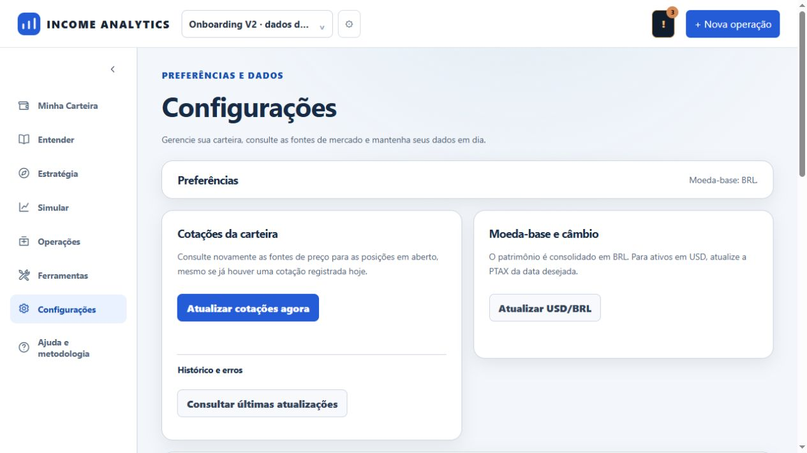
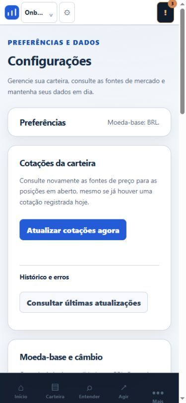
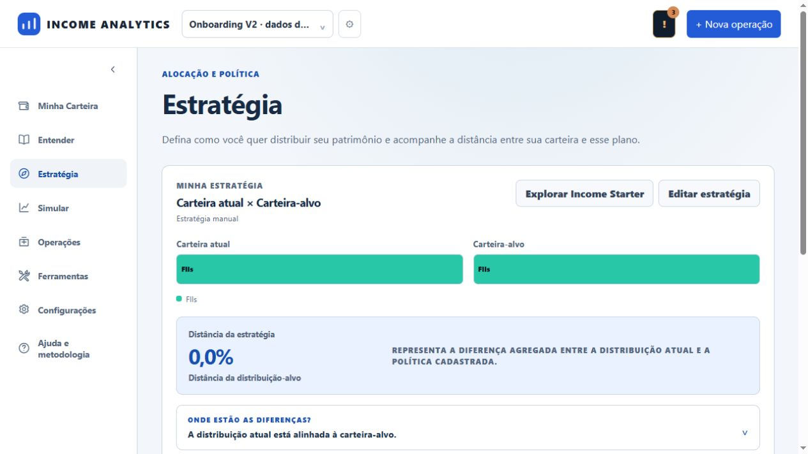
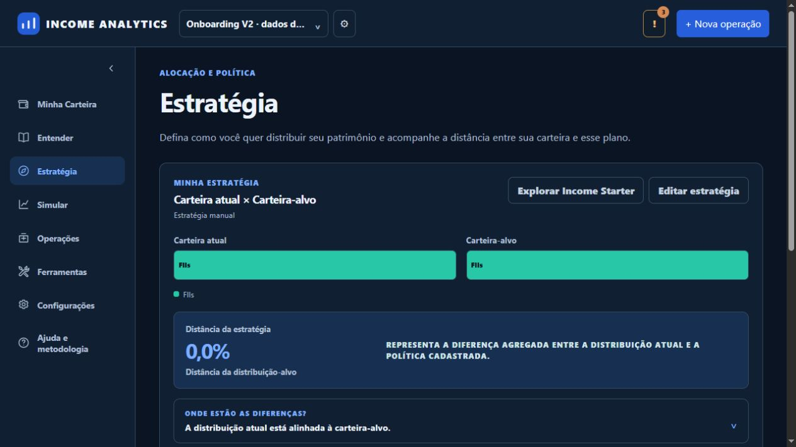
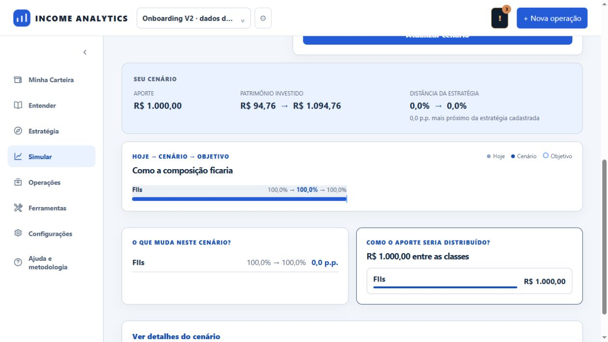
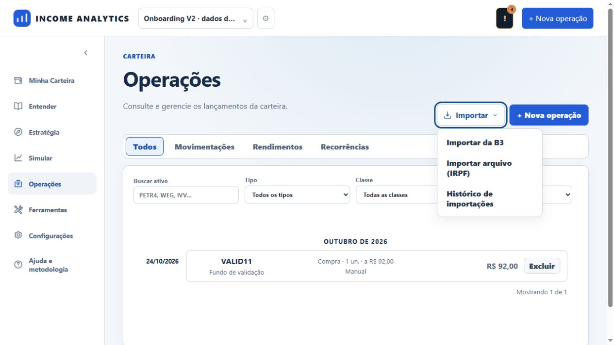
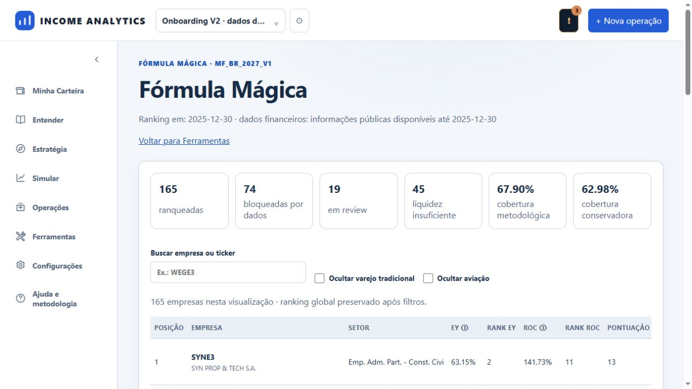

# Temas e Configurações V2

Corrige os destaques verdes e as superfícies fixas escuras que deixavam Estratégia e Simular ilegíveis no tema claro. Usa os tokens semânticos V2 nos dois temas, incluindo editor, comparação, composição por ativos e detalhes do cenário. As cores das classes dos gráficos permanecem categorias de dados.

Operações recebe Importar compacto com SVG, menu nativo acionável por teclado e abas legíveis. Configurações usa cartões responsivos, preferências compactas, ações de tamanho natural e catálogo de fontes. A ordem visual acompanha a ordem dos controles no DOM. A descrição da carteira agora informa acesso privado autenticado.

## Arquivos e reutilização
- `static/css/feature-theme-v2.css`: camada de superfícies e estados semânticos; utiliza os tokens existentes do design system.
- `static/index.html`: estilos, botão Importar e textos de configurações.
- `static/js/features/data-sources.js`: cartões criados com DOM/textContent, estados vazio e erro.
- `static/js/features/fx.js`: posição do cartão de câmbio na sequência de navegação.
- `api/saas_security.py`: catálogo público estático para sessões Firebase autenticadas.
- `tests/security/test_firebase_authorization.py` e `tests/frontend/settings_sources_v2.mjs`: catálogo protegido e renderização segura.

Reutiliza editor/validações de estratégia, APIs de simulação e importação, confirmações de exclusão, autenticação e tokens AA existentes. Nenhum cálculo, migração ou dado pessoal foi alterado.

## Validação
- 47 testes Python distintos aprovados: 28 de módulos frontend e 19 de autorização Firebase; as execuções incluem repetição do novo teste do catálogo após formatação.
- 6 suites Node aprovadas: strategy_ux_v2, simulation_experience_v2, operations_workspace_v1, portfolio_v2, saas_xss_characterization e settings_sources_v2.
- Navegador com SQLite descartável: editor de estratégia, cenário calculado de aporte, erro por cotação ausente, menu Importar via Enter, ranking de 165 empresas, Configurações desktop e mobile de 390 px; sem overflow horizontal da página nas telas medidas.
- Tema escuro inspecionado em Estratégia. Tokens AA verificados pelo teste existente portfolio_v2.
- Não houve login Firebase real nem publicação desta revisão. Os testes de autorização usam IdP determinístico.

## Segurança e limites
O catálogo autenticado só informa fornecedores e descrições públicas, sem logs, última execução real ou agendamentos globais. Status desconhecido é apresentado como consulta sob demanda, nunca como sucesso presumido. A lista não implica conexão bancária ou atualização em tempo real. Fontes locais podem conter mais fornecedores que o catálogo seguro SaaS.

As capturas usam dados sintéticos. O ambiente produtivo permanece na versão anterior até revisão/merge. A interface interativa do gráfico de pizza permanece em PR independente.

## Evidências visuais

