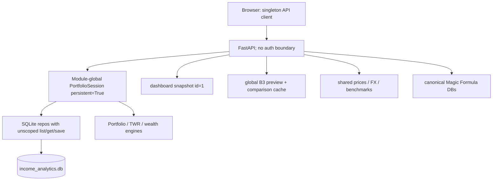

# Current architecture (2026-10-18)

The browser calls `/api/...` with no portfolio context. Router handlers directly reuse one process-global persistent session that preloads the current dataset. `financial_events.account_id` is indexed legacy metadata, not a tenant boundary (no FK or authorization use). A dashboard JSON snapshot is a singleton. Shared market/reference data and user portfolio data coexist in one primary SQLite database; Magic Formula has separate SQLite files.
