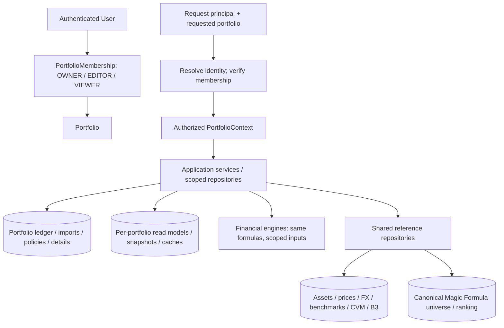

# Target architecture (concept only)

Required boundary: authenticated principal → requested portfolio → membership validation → scoped service/repository. Never authorize using a client-supplied portfolio ID alone. Identity is separate from finance domain. Keep global market and canonical Magic Formula data shared. A future consolidated `ALL_PORTFOLIOS` view is an aggregate projection, not another portfolio; transfer elimination and consolidated performance are out of scope here.
