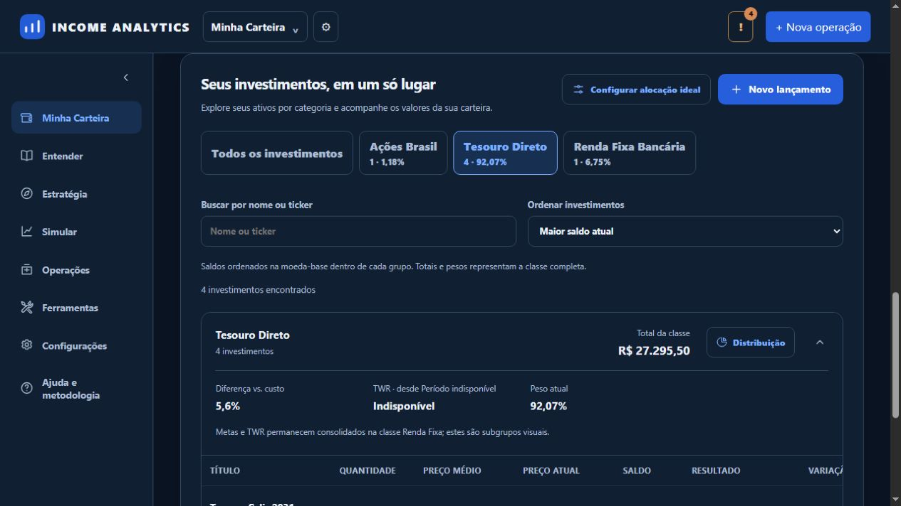
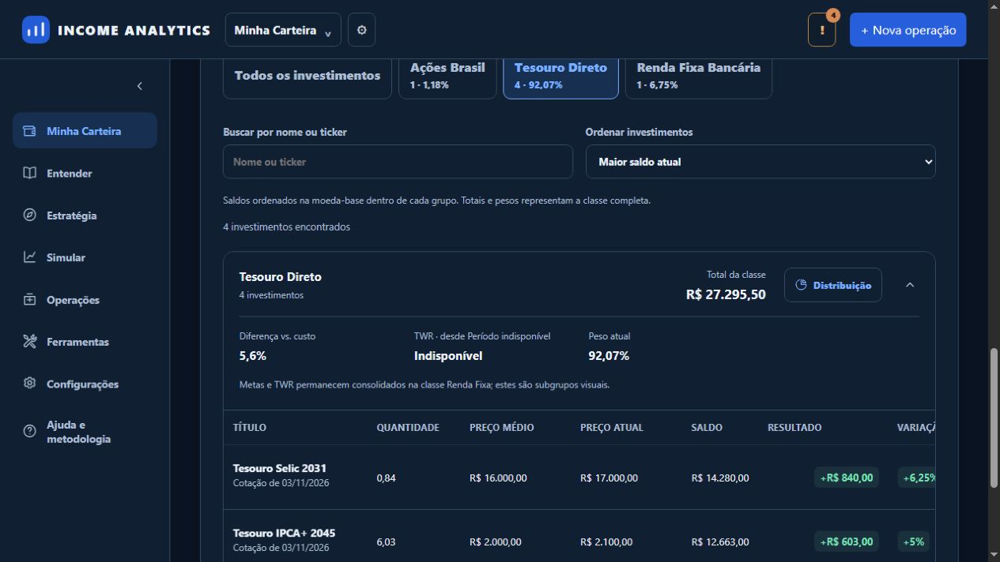
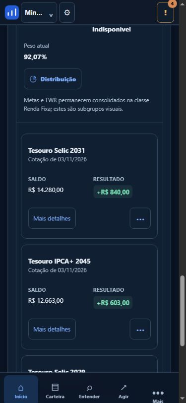
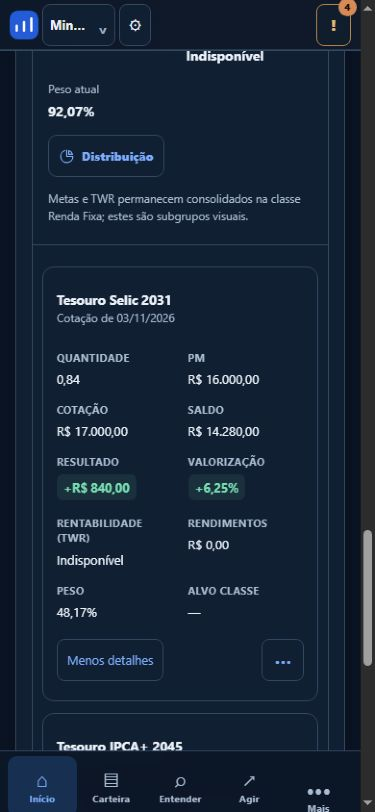
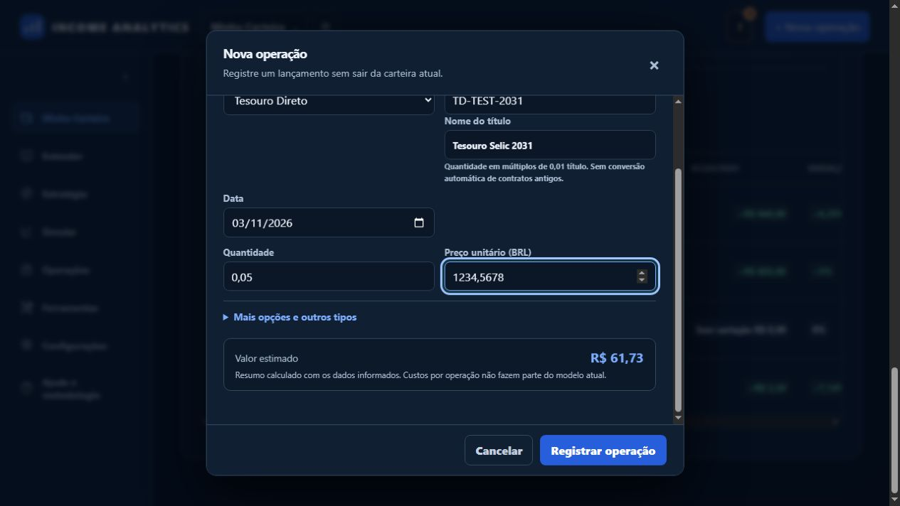

# Issue 61 — implementação e evidências

Diagnóstico iniciado em 02/11/2026; validação final local em 03/11/2026. Requisitos e limites estão em [diagnosis.md](diagnosis.md). Resultados verificáveis: [evidence.json](evidence.json).

## Alterações e componentes

- Reutilizados: Minha Carteira V2, tabelas/cartões responsivos, busca/filtros/ordenação escolhida, detalhes acessíveis, menus e histórico de lançamentos; eventos/Quantity/Money em Decimal; parser e transação B3; alocador global de aportes e campos de custos/restrições por instrumento; repositórios e snapshot consolidado existentes.
- Criados: taxonomia/nomenclatura/fronteiras de validação em `application/treasury.py`; contratos de apresentação em `application/holdings_display.py`; persistência de revisões com comparação de versão e escopo da carteira em `infrastructure/treasury_revisions.py`.
- Integrados: `api/routers/dashboard.py`, `application/portfolio_session.py`, `application/executable_contribution.py`, frontend `portfolio.js`, `operations.js`, `simulation-executable.js`, `api.js`, HTML e estilos existentes.
- Read model versão 5: acrescenta `display_groups`, mantendo `classes` e a identidade financeira original. O mecanismo existente de renovação no startup local detecta a versão antiga. Não há migração de tabela nem alteração de eventos ao renovar a apresentação.
- O ledger de qualidade mantém os 803 IDs históricos e todos os registros `before`; atualiza localizações/hashes de fontes revisadas e registra 13 diagnósticos resolvidos pelo contrato tipado, sem novas exceções de mypy/Ruff.

## Antes/depois com o mesmo snapshot sintético

Esta comparação usa dados fabricados de teste, com preços iguais antes/depois; não é uma medição da carteira real nem um screenshot da produção anterior. “Antes” representa a classe financeira consolidada que a UI anterior exibia; “depois” é a partição visual da mesma projeção.

| Indicador | Antes | Depois |
|---|---:|---:|
| Saldo de mercado total | R$ 29.645,50 | R$ 29.645,50 |
| Custo registrado | R$ 28.149,00 | R$ 28.149,00 |
| Resultado projetado | R$ 1.496,50 | R$ 1.496,50 |
| Renda Fixa consolidada | R$ 29.295,50 | R$ 29.295,50, preservada em `classes` |
| Tesouro, subgrupo visual | Misturado | R$ 27.295,50 |
| Bancária, subgrupo visual | Misturado | R$ 2.000,00 |
| Ações Brasil | R$ 350,00 | R$ 350,00 |

A ordem visual do Tesouro é Selic 2031 (R$ 14.280,00), IPCA+ 2045 (R$ 12.663,00), contrato legado Selic 2029 (R$ 300,00) e Prefixado 2032 (R$ 52,50). Quantidades 0,84, 6,03 e 0,07 permanecem intactas; o legado mostra unidade de contrato, não uma quantidade fictícia de títulos. A simulação de R$ 55,00 a R$ 1.000,00/título compra 0,05 título e preserva R$ 5,00 de saldo residual.

## Testes e comandos

Usar o ambiente reproduzível e o isolamento já definidos em `ci/run.py::isolated_environment`; SQLite descartável, jobs externos desativados e sem credenciais produtivas.

| Verificação | Resultado |
|---|---|
| Suíte offline completa, incluindo testes CI | 1.416 passaram; 15 falhas, 9 erros, 5 skips, todos preexistentes; 28 novos casos passaram |
| Comparação individual com baseline b642709 | Nenhum caso existente mudou de resultado |
| Rodada final após precedência de taxonomia e renovação do snapshot | 167 passaram, 0 falhas, 0 erros; 5 skips externos explícitos |
| Frontend final, após revisão de ordenação de contratos com múltiplos lotes | 33 suítes passaram |
| Ruff completo | PASS pela política existente: 23 ocorrências históricas exatas de estilo em migrações imutáveis; nenhuma ocorrência nova |
| mypy completo | 486 diagnósticos contra 499 na baseline; zero novos; não é um gate limpo |
| Quality non-regression | PASS; histórico original e multiplicidade preservados |
| Certificação financeira | BLOCKED: 104 passaram, 15 falharam, 9 erros; inclui execução e falha de `test_shares_unit_020_frozen_engine` |
| Integridade | 41/41 arquivos imutáveis idênticos; checkouts principal e PR12 preservados |

O checkpoint completo precede três testes adicionais e os pequenos ajustes finais de precedência de classificação/snapshot. A rodada final focada valida essas alterações. Não se somam execuções sobrepostas para fabricar um total de aprovação. Os relatórios hospedados do SHA do PR devem ser consultados separadamente.

Comandos principais, a partir do diretório da aplicação:

```powershell
python ci/governance.py --check python
python ci/governance.py --check financial
python ci/governance.py --check quality
python ci/governance.py --check ruff
python ci/governance.py --check node
```

Os novos testes estão em `tests/application/test_treasury.py`, `tests/api/test_treasury.py`, `tests/infrastructure/test_treasury_revisions.py`, `tests/frontend/treasury_holdings.mjs` e `treasury_operations.mjs`, com extensões de importação/API e simulação nas suítes existentes. Cobrem 0,05 título, venda parcial, saldo residual, oversell, precisão/inconsistência financeira, edição/revisão obsoleta, isolamento por carteira, nomenclatura, precedência de taxonomia, totais/pesos, busca e ordenação de todos os grupos, inclusive contratos agrupados por múltiplos lotes.

Os 5 skips são os 4 casos de Firebase Emulator e o caso Firebase cloud, fora do escopo offline. Não foram introduzidos skips, xfails, exclusões de módulos ou alterações de expectativas financeiras.

## Evidências visuais

Capturas do aplicativo real em servidor loopback com banco descartável **exclusivamente sintético**, sem dados pessoais. Desktop padrão e viewport móvel 390 × 844. Formulários abertos/preenchidos e cancelados; nenhuma operação de corretora foi enviada.











## Critérios e pendências

| Critério | Estado/evidência |
|---|---|
| Separar Tesouro e bancária | Atendido visualmente; a classe financeira permanece estável |
| Nomes legíveis e fallback | Atendido para famílias reconhecidas; identificação desconhecida explícita e sem inferir código/principal |
| Ordenação decrescente e busca | Atendido em todos os grupos; empates por nome, inválidos no fim; escolha explícita preservada; saldos em moeda-base |
| Patrimônio/pesos/metas | Invariantes sintéticas reconciliadas e histórico preservado; metas e TWR continuam consolidados, sem duplicação quando há múltiplos subgrupos; carteiras exclusivamente bancárias mantêm os indicadores originais |
| Compras/vendas/edição/importação/simulação fracionárias | Atendido para títulos tradicionais já representados em unidades de título e identificados/resolvidos |
| Quantidade mínima/precisão e restrições de outros ativos | Incremento de 0,01 título validado; regras B3 inteiras na simulação e controles; frações internacionais/cripto preservadas pelos testes existentes |
| Contratos legados | Pendente de conciliação independente: não converter unidades de contrato em títulos automaticamente |
| RendA+/Educa+ | Identificação visual suportada; negociação bloqueada até política específica, incluindo carência, ser implementada e validada |
| Rentabilidade individual | TWR individual não criado nem substituído por variação de preço; indisponibilidade explicitada. TWR financeiro consolidado preservado |
| Referências de preço/custos | Não há novo feed oficial de preços. Cotações existentes e custos informados continuam sujeitos às validações existentes; registro manual não incorpora taxas ocultas no valor bruto |
| Homologação da carteira real e certificação global | Pendente: dados reais não foram alterados e CERT_48/históricos permanecem bloqueadores de release |

Nenhuma regra congelada, fixture financeira, manifesto ou hash foi alterado. A issue **não é declarada encerrada**. Não houve merge, deploy, relaxamento de gates ou mudança de proteção de branch.

## Ativação e recuperação propostas, sem execução

Após revisão e aprovação dos gates aplicáveis, a ativação deverá renovar o snapshot por carteira com o mecanismo existente. Em SaaS, o startup global é deliberadamente desabilitado: usar o rebuild explícito autorizado no contexto de cada carteira, sem executar um job global sobre outros proprietários. Este PR não chama esse endpoint em produção.

Como não há migração destrutiva, o retorno à versão anterior pode manter o mesmo schema. Entretanto, novas operações fracionárias e o histórico de revisões devem ser preservados: não remover lançamentos nem restaurar um banco antigo sobre dados novos. Validar leitura e reconciliação em homologação e seguir o runbook existente de rollback/backup. A integração com o PR12 exige revisão de conflitos posterior, sem sobrescrever aquele trabalho.
